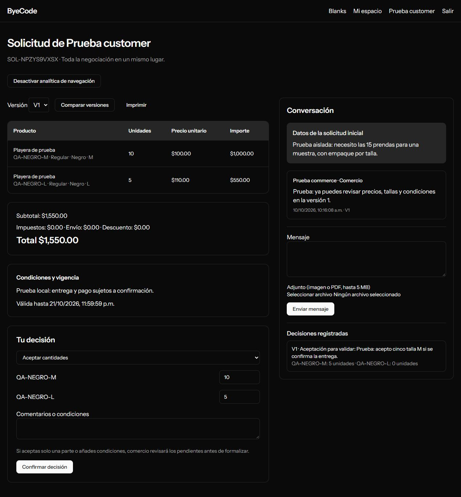
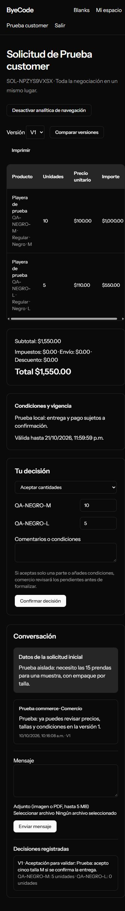
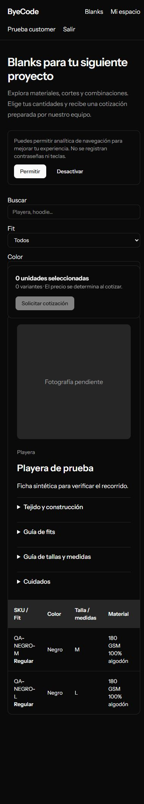

# Comprobación del recorrido de cliente — 10 de octubre de 2026

Recorrido comprobado en una base SQLite temporal con tres cuentas `example.test`, dos variantes sintéticas y servicios externos desactivados. La cuenta real del administrador y PostgreSQL no se usaron para estas operaciones.

1. Catálogo público: tallas, fit, color, gramaje y cantidades; sin importes.
2. Selección de 10 unidades M y 5 L; acceso obligatorio y recuperación de cantidades después de iniciar sesión.
3. Primera solicitud con notas: un cliente CRM y una oportunidad sin importe.
4. Bandeja de comercio; preparación y recuperación de borrador interno.
5. Publicación de una versión por $1,550 MXN (dato sintético), con dos líneas y vigencia.
6. Mensaje de comercio visible al comprador dentro del aplicativo.
7. Aceptación de 5 unidades M y 0 L con condición de entrega; decisión conservada y oportunidad abierta.
8. Catálogo y cotización a 390 px, sin desbordamiento de la página. Tablas con desplazamiento propio cuando es necesario.

La comprobación detectó y corrigió un caso de ficha sin fotografías, la zona horaria de mensajes leídos mediante consultas directas y el ancho mínimo de la tabla en móvil. También se hizo visible la nota inicial y el detalle de cantidades de cada decisión. Los errores de fecha al rellenar el control nativo desde la automatización se resolvieron usando interacción de teclado; el backend rechazó correctamente la vigencia vacía.

Capturas con datos sintéticos, sin credenciales:

Las pruebas automatizadas y su alcance están en `ESTADO_DESARROLLO.md`. Las capturas no prueban envío real de correo, calidad lingüística de IA ni precisión predictiva comercial.
