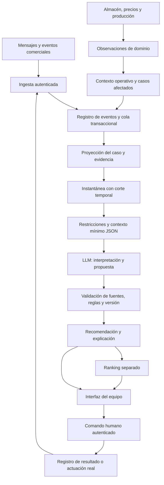

## 7.22. Arquitectura de información de ByeCode: del evento a la decisión

**Diseño propio v1.0 del flujo de datos.** Complementa las reglas, explicaciones y contratos de 7.1–7.21. El PDF conserva su función como referencia del núcleo; este apartado define cómo conectar ese núcleo con el negocio. Los nombres nuevos, sobres, rutas, tablas y extensiones siguientes son una propuesta de implementación de ByeCode. Los ejemplos son sintéticos. No presuponen integraciones ya disponibles ni políticas comerciales aprobadas.

### 7.22.1. Qué información debe viajar y para qué

La unidad de decisión es el **caso comercial asociado a una cotización enviada**. Un cliente puede tener varios casos; cada caso puede tener varias versiones de cotización, varias líneas, aceptaciones parciales y una secuencia propia de eventos. Cada frontera transportará únicamente la información necesaria para su responsabilidad, con identidad, fecha, versión, procedencia y límites.

| Capa | Información que recibe | Información que entrega | Responsable |
|---|---|---|---|
| Fuentes | Interacciones del comprador, registros del vendedor, cotización publicada, almacén y producción | Eventos u observaciones con identidad de origen | Aplicación o integración autorizada |
| Ingesta | Payload de origen y credenciales del canal | Evento validado y acuse, o rechazo/cuarentena | Backend |
| Registro y proyecciones | Eventos aceptados y observaciones verificadas | Historial, estado del caso, versiones y métricas | Backend |
| Constructor de contexto | Estado, evidencia, restricciones, faltantes y corte temporal | Instantánea inmutable y proyección mínima para IA | Backend |
| Modelo | JSON de contexto seleccionado y políticas aplicables | Interpretación con fuentes, propuesta y explicación estructurada | LLM |
| Validación y publicación | Propuesta, instantánea y estado vigente | Recomendación válida o estado técnico de bloqueo | Backend |
| Priorización | Recomendaciones vigentes y criterios comparables | Ranking independiente con comparaciones y exclusiones | Comparador del backend |
| Interfaz | Recomendación, explicación, evidencia autorizada y estado | Consulta, aprobación, rechazo o registro humano | Vendedor/supervisor |
| Retroalimentación | Decisión humana y resultados observados | Señales de evaluación, sin alterar los hechos originales | Backend y equipo |



No existe una flecha directa del modelo al comprador, al precio, al inventario o al cierre. Una visualización puede actualizar métricas sin consumir una evaluación del LLM; un cierre o una nueva restricción sí invalida inmediatamente una recomendación incompatible.

### 7.22.2. Identidades y relaciones que no deben confundirse

| Identificador | Qué representa y cómo se utiliza |
|---|---|
| `tenant_id` | Empresa propietaria; se deriva de la autenticación. Aísla eventos, consultas, trabajos, archivos y cachés. |
| `customer_id`, `contact_ref` | Cuenta comercial y persona/canal. Son referencias distintas. Los destinos reales se resuelven en un servicio autorizado. |
| `case_id` | Hilo de decisión. Su cierre definitivo no se revierte por una nueva interacción; una nueva oportunidad usa otro caso enlazado. |
| `quote_id`, `quote_version` | Cotización y versión publicada. Se preservan las anteriores para interpretar qué vio o aceptó el comprador. |
| `line_id`, `sku_id` | Línea comercial y variante del catálogo. Una línea con talla pendiente todavía no tiene necesariamente un SKU completo. |
| `event_id`, `source_event_id` | Evento canónico y clave del proveedor. Se mantiene una correspondencia estable, única dentro de empresa y fuente. |
| `snapshot_id`, `context_version`, `case_sequence` | Instantánea, revisión del contexto y posición de aplicación por caso. No son la versión de la cotización. |
| `evaluation_id`, `recommendation_id` | Intento de evaluación y recomendación persistida. El segundo queda fuera de los once campos oficiales. |
| `ranking_id`, `command_id`, `feedback_id` | Priorización, intención humana y retroalimentación. No equivalen a un evento de ejecución. |
| `correlation_id`, `causation_id` | Recorrido completo y antecedente inmediato. Sirven para rastrear un cambio sin copiar el contenido sensible a los logs. |

Toda relación se comprueba dentro del mismo `tenant_id`. No basta con conocer un ID para consultar su contenido. Una relación con el mismo cliente tampoco permite usar mensajes de otra cotización como evidencia de este caso sin una vinculación explícita, autorizada y trazable.

### 7.22.3. Cuatro tiempos y una política de conocimiento

- `occurred_at`: cuándo ocurrió el hecho en la fuente; UTC normalizado, conservando el valor original cuando haya conversión.
- `received_at`: cuándo llegó al adaptador; lo escribe el servidor.
- `ingested_at`: cuándo quedó aceptado y persistido. El acuse se emite después de esa persistencia.
- `evaluation_at`: momento comercial que se evalúa. `knowledge_cutoff` registra además hasta qué momento de ingesta se permite conocer información.

Una evaluación admite eventos con `occurred_at <= evaluation_at` e `ingested_at <= knowledge_cutoff`. Las referencias a proyecciones y observaciones deben pertenecer a esa misma instantánea. Esto evita que una prueba histórica use información que llegó después. Un reprocesamiento retrospectivo que incorpore datos tardíos crea otra evaluación, identificada como tal; no sobrescribe lo que el sistema sabía originalmente.

Un evento tardío conserva sus fechas y genera una nueva revisión del contexto. Se reconstruyen los campos afectados con reglas de autoridad y revisión del dominio; **orden de llegada no equivale a orden comercial**. Si dos cambios incompatibles tienen la misma fecha y no existe una revisión de origen que los ordene, se registra conflicto. Las horas imposibles o futuras fuera de la tolerancia configurada se apartan para revisión. La tolerancia debe configurarse: no se inventa aquí un margen universal.

El reloj se inyecta en las pruebas. Las 24 horas de R4 son horas transcurridas, no un día hábil. Horario comercial, zona del comprador y fechas ambiguas requieren política o aclaración; se conserva el texto original y no se supone una zona horaria.

### 7.22.4. Catálogo de eventos comerciales

El cuerpo canónico conserva `event_id`, `case_id`, `event_type`, `occurred_at` y `data`. El contrato propuesto tipifica `data`; los metadatos de transporte y autenticación viven en otro sobre. Los adaptadores pueden recibir formatos externos diferentes, pero deben normalizarlos antes del registro.

| Tipo del núcleo | Datos de negocio que viajan | Fuente autorizada y efecto |
|---|---|---|
| `case.opened` | Estado inicial; importe MXN si está disponible; referencias opcionales de cliente y cotización | Backend comercial; inicia el seguimiento de una cotización ya enviada. Los datos ausentes no se completan por intuición. |
| `proposal.viewed` | Versión vista cuando se conoce, sesión seudónima opcional, calidad de atribución | Instrumentación validada; cuenta una apertura deduplicada. No prueba compra ni autoriza identificar a un visitante anónimo. |
| `message.received` | Texto, referencia del mensaje y conversación, canal, atribución del remitente, versión referida si consta, referencias de adjuntos | Conector o captura autorizada; conserva preguntas, cantidades, objeciones y condiciones. Un mensaje no verifica stock ni formaliza una venta. |
| `action.executed` | Tipo de acción real, referencia de ejecución, actor, canal y destinatario referido | Registro autorizado con comprobante; actualiza el historial de acciones y R4 cuando corresponda. Aprobación y borrador no lo generan. |
| `constraint.updated` | Parche de `contact_allowed` y/o `contact_not_before`, motivo y referencia de autoridad | Servicio de restricciones; ausencia significa conservar. `contact_not_before:null` es una eliminación explícita que requiere autoridad; `contact_allowed:null` no se admite. |
| `case.closed` | Estado terminal y, si consta, motivo y referencia de resultado | Responsable autorizado; activa R1. Un cierre puede ser ganado, perdido u otro cierre permitido por el catálogo del negocio; el importe por sí solo no determina cuál. |

**Extensiones propuestas, separadas del núcleo del PDF:**

| Extensión | Payload mínimo propio | Efecto permitido |
|---|---|---|
| `proposal.version_published` | `quote_id`, `quote_version`, `snapshot_ref`, `previous_version` | Registra una modificación publicada de la cotización y conserva la anterior. Un borrador no cuenta. |
| `proposal.acceptance_recorded` | Cotización/versión, referencia del registro de aceptación y del mensaje de origen | Registra qué líneas/cantidades se declararon aceptadas y sus condiciones; no confirma pedido. |
| `order.formalized` | Pedido, cotización/versión, registro de formalización y evidencia de autorización | Vincula cantidades formalizadas después de las comprobaciones de negocio. No cierra automáticamente todo el caso. |
| `case.context_updated` | Referencias de observaciones reales, dominios afectados y motivo | Incorpora stock, capacidad, catálogo, precio u otro dato autorizado relacionado con el caso. Se genera por una observación realmente registrada; nunca para fabricar evidencia. |
| `action.failed` | Referencia de intento, estado fallido o desconocido y código de error | No activa R4 como si existiera un contacto confirmado. Un resultado desconocido bloquea el reintento hasta conciliarlo. |
| `case.review_due` | Referencia de agenda y recomendación que programó la revisión | Pide reevaluar con el estado actual. No envía la acción ni demuestra interés del comprador. |

Los registros de aceptación y formalización enlazados contienen las líneas, cantidades, condiciones y autorizaciones que se detallan más adelante. Las extensiones usan un registro de esquemas propio y validación por tipo; no se presentan como tipos exigidos por el PDF. Un consumidor limitado al núcleo no las reinterpreta silenciosamente como otro tipo.

### 7.22.5. Entrada, normalización y acuse

La petición llega por un canal autenticado con clave de idempotencia y versión del contrato. El backend comprueba origen, firma cuando corresponda, permisos, empresa, pertenencia del caso, esquema, fechas y tamaño. La identidad del actor y los tiempos de servidor no se aceptan como afirmaciones libres del navegador.

1. Normalizar sin perder el original: fechas, codificación, IDs de origen y unidades. Conservar un original restringido y su huella; la política de retención limita su conservación.
2. Validar el perfil del evento. Un campo extra desconocido no se incorpora automáticamente al contexto del LLM.
3. Consultar la clave `(tenant_id, source, source_event_id)` y la identidad canónica. Mismo ID y contenido equivalente: devolver el recurso existente. Mismo ID y contenido distinto: conflicto, sin sobrescritura.
4. Persistir en una transacción el evento aceptado y una tarea de procesamiento en la cola transaccional. Esto evita confirmar recepción y perder después el trabajo.
5. Responder con `accepted`, `duplicate`, `rejected` o `quarantined`, referencias y errores estructurados. `accepted` significa persistido; no significa evaluado ni recomendado.

Los errores incluyen `code`, `field_path`, `retryable` y un mensaje legible sin contenido sensible. Ejemplos: `SCHEMA_INVALID`, `IDEMPOTENCY_CONFLICT`, `CASE_NOT_FOUND`, `SOURCE_NOT_AUTHORIZED`, `CLOCK_UNCERTAIN`. Un fallo que puede ocultar un cierre o una prohibición de contacto marca el caso como incompleto y bloquea nuevas recomendaciones de contacto hasta resolverlo. Un lote devuelve un acuse por elemento; el error de un caso no borra los demás.

### 7.22.6. Información comercial de prendas blank

| Entidad | Campos que se conservan | Regla de interpretación |
|---|---|---|
| Cuenta y contacto | Referencias, tipo de relación comercial, canal autorizado y preferencias documentadas | Nombres, teléfonos, correos y direcciones completas se resuelven fuera del contexto del LLM salvo necesidad concreta. |
| Cotización | ID, versión, estado de publicación, moneda, vigencia conocida, responsable, totales y condiciones | La versión enviada es inmutable. Cambiar cantidades o precios crea otra versión cuando se publica. |
| Línea | `line_id`, prenda/modelo, corte, tejido/composición, gramaje, color, cantidad y modalidad de abastecimiento | No ofrecer impresión, bordado o logotipos. Una personalización solicitada se identifica como fuera de alcance o se escala. |
| Variante | SKU confirmado o nulo, talla, color, cantidad y estado de resolución | La talla desconocida no se transforma en talla estándar ni en cero piezas. |
| Precio | Moneda, importe en unidades monetarias menores, unidad comercial, descuentos, impuestos, flete y aprobación si existen | Una cifra ausente es `null` con motivo. No inferir impuestos ni descuentos autorizados. En el contexto propio, MXN se representa en centavos enteros para evitar ambigüedad decimal. |
| Abastecimiento | Cantidades previstas de stock y producción, reservas verificadas y cantidades todavía sin asignar | Previsión de stock no equivale a reserva; capacidad no equivale a fecha prometida. |
| Entrega | Fecha solicitada, fecha confirmada, responsable y evidencia, zona necesaria y punto de entrega referido | La fecha pedida por el comprador no es un compromiso de la maquiladora. |
| Aceptación | Versión, líneas/cantidades, condición, mensaje/evidencia, actor y momento | “Acepto si…” conserva la condición. Lo no mencionado sigue sin resolverse. |
| Formalización | Pedido, cantidades por línea, criterios cumplidos, referencia de autorización/pago cuando corresponda y responsable | Solo la fuente autorizada formaliza. No se almacenan datos completos de tarjetas ni credenciales bancarias. |

En cada línea se distinguen cantidades **solicitadas, cotizadas, declaradas aceptadas, formalizadas, canceladas y pendientes**. Son etapas con sus propias fuentes, no columnas sumables entre sí. Solo las particiones del mismo total se suman: distribución por talla y asignación de abastecimiento, por ejemplo. Si la línea tiene 500 piezas y faltan tallas, puede registrar 500 pendientes de distribución; no se inventan cinco tallas de 100.

Para un pedido mixto de 500 prendas, 300 previstas de inventario y 200 de fabricación describen una propuesta de abastecimiento. Una recomendación no convierte esas 300 en reserva ni las 200 en capacidad aprobada. Los cálculos monetarios siguen la unidad de precio y reglas de redondeo configuradas; los totales se validan contra sus componentes cuando están completos, sin reemplazar importes desconocidos por cero.

### 7.22.7. Observaciones operativas y autoridad de las fuentes

Almacén, catálogo, precios y producción pueden emitir cambios por SKU o recurso sin pertenecer todavía a un caso. Se registran como `domain_observation`: ID, dominio, entidad, fuente/revisión, `as_of`, `received_at`, vigencia si existe, valores tipados y unidades. Un índice identifica cotizaciones abiertas que dependen de ese recurso. El backend vincula la observación y produce un `case.context_updated` por caso afectado de forma idempotente.

| Dato | Fuente que puede verificarlo | Qué no lo reemplaza |
|---|---|---|
| Stock físico, comprometido y disponible para prometer | Almacén o servicio autorizado, con fórmula y revisión | Una cantidad mostrada en una cotización vieja |
| Reserva | Operación confirmada del sistema de reservas | Intención del vendedor o recomendación del modelo |
| Capacidad, lote y plazo de producción | Producción y su responsable | Necesidad de entrega expresada por el comprador |
| Precio y descuento aplicables | Catálogo y flujo autorizado de aprobación | Una oferta sugerida por el LLM |
| Cantidad, presupuesto y fecha deseados | Declaración atribuida del comprador | Aperturas o patrones de navegación |
| Restricción de contacto | Registro autorizado y solicitudes restrictivas verificables | Un mensaje ambiguo que aparentemente invita a insistir |

Cada valor decisivo debe tener fuente, unidad, fecha y condición de vigencia. Si no existe una política de caducidad de stock, se declara `freshness=unknown` y se revalida antes de comprometerlo; no se elige un TTL arbitrario. No se fusionan fuentes contradictorias mediante un promedio ni por “la última que llegó”. El historial conserva el conflicto y su resolución autorizada.

### 7.22.8. Estado persistido y evidencia

La proyección del caso contiene estado, versión de cotización, líneas, restricciones acumuladas, compromisos abiertos, últimas acciones reales y mensajes relevantes. Cada atributo decisivo apunta a un hecho o evento verificable.

Un hecho derivado se representa mediante `fact_id`, `path`, `value`, `unit`, `kind`, `evidence_event_ids`, `as_of`, `freshness` y `status`. `kind` distingue `verified_fact`, `buyer_statement`, `inference` y `unknown`. Una inferencia nunca asciende a hecho por repetirse en resúmenes. Un `unknown` conserva `value:null` y la razón en los faltantes; un conflicto conserva las fuentes incompatibles en registros separados.

Los mensajes relevantes llevan ID, texto mínimo necesario, atribución y versión de cotización referida si se conoce. La evidencia del contexto usa referencias a eventos realmente registrados y rutas de campo; las citas textuales se verifican contra el original. Adjuntos quedan como referencias con estado de extracción. Texto no extraído, ilegible o atribución incierta se declara pendiente; no se inventa su contenido.

Las métricas tienen nombre, valor o `null`, unidad, ventana, corte, fórmula/versionado y eventos de origen: tiempo desde último contacto confirmado, edad de una solicitud sin respuesta, aperturas deduplicadas y días desde una versión enviada. Una ventana incompleta no produce un cero tranquilizador. “Sin contactos conocidos” solo habilita R4 si el historial relevante se considera completo.

### 7.22.9. Instantánea y JSON In del modelo

El backend genera una instantánea inmutable: `snapshot_id`, `case_id`, `context_version`, secuencia aplicada, `evaluation_at`, `knowledge_cutoff`, versión de políticas, hechos, cotización vigente, restricciones, métricas, evidencia y faltantes. El JSON In del LLM es una **proyección seleccionada** de esa instantánea.

El contrato `model_request` incluye `evaluation_id`, caso/versión, cortes temporales, versión de política y prompt, tarea permitida, contexto comercial necesario, evidencia seleccionada y acciones preliminarmente admisibles. También incluye `data_quality`, cobertura del historial y referencias omitidas por límite de contexto. Los secretos, destinos de envío, credenciales, registros de otros clientes y objetos operativos completos no viajan al modelo.

La selección prioriza restricciones vigentes, cierre, versión publicada, solicitudes pendientes, objeciones activas, última acción real, mensaje posterior relevante y evidencia de stock/capacidad cuando la decisión lo necesite. Los resúmenes se conservan con referencias y versión; nunca reemplazan los mensajes o restricciones originales. Si el presupuesto de contexto obliga a omitir evidencia decisiva, se marca incompleto y no se publica una intervención sustentada en esa ausencia.

Un opt-out o una petición de espera en texto requiere interpretación antes de volver a habilitar contacto. El modelo puede identificar esa señal restrictiva con cita; el backend aplica el bloqueo conservador y, si hace falta, revisión humana. Una señal semántica puede restringir, pero no levantar por sí sola una prohibición autorizada. Las acciones indicadas en el JSON In son preliminares hasta procesar esas señales.

### 7.22.10. JSON Out interno del modelo

El modelo devuelve `model_response` con la identidad de evaluación, caso y contexto recibidos; `signals`; una `candidate` con los once campos oficiales; y `explanation`. Esto permite separar interpretación de decisión y validar ambas.

Cada señal contiene etiqueta —pregunta, objeción, cambio solicitado, aceptación condicional, solicitud de espera, exclusión de contacto o ambigüedad—, descripción, IDs de evidencia y fragmento pertinente. Se permiten varias señales sobre un mismo mensaje. Las señales no ejecutan cambios en la cotización, no reservan stock y no crean un pedido.

La explicación estructurada conserva: criterios realmente usados con evidencia; alternativas consideradas y motivo de descarte; restricciones aplicadas; información faltante; y qué cambio concreto podría modificar la recomendación. No pide ni almacena una cadena privada de razonamiento del modelo. Es una justificación verificable orientada al usuario y a auditoría, coherente con 7.12.

La certeza de la propuesta es cualitativa y se refiere a esa acción. Pedir tallas puede estar bien justificado aunque la compra sea incierta. No se añaden probabilidad de cierre, score de urgencia o retorno esperado sin un método validado y datos que los sustenten.

### 7.22.11. Controles del backend antes de publicar

1. Verificar JSON, contrato, enumeraciones y correspondencia exacta de evaluación, caso y contexto.
2. Comprobar que cada ID citado existe en la evidencia permitida del caso, con ambos cortes temporales y acceso válido. Comprobar que las citas y valores concuerdan con las fuentes.
3. Revisar interpretación: no confundir apertura con intención, declaración con hecho operativo o aceptación con formalización. El soporte semántico puede requerir revisión humana; un JSON Schema no lo demuestra.
4. Aplicar R1–R6 y restricciones semánticas conservadoras. Comprobar acción, texto, timing y condiciones; ninguna acción interna puede ocultar un contacto prohibido.
5. Validar coherencia de explicación, riesgo, confianza, faltantes y revisión humana. No se rellena un campo obligatorio inventando evidencia.
6. Comparar atómicamente la versión evaluada con la versión actual del caso y dependencias operativas. Si cambiaron, marcar resultado obsoleto y reevaluar; no publicarlo como vigente.
7. Persistir recomendación y explicación vinculadas. El publicador asigna IDs, modelo usado, políticas, tiempos y resultados de validación. El LLM no certifica su propia aprobación.

R1 limita el caso cerrado a `no_action`. R2 y R3 bloquean las tres acciones hacia el comprador. R4 respeta la pausa de 24 horas y su excepción por un mensaje estrictamente posterior a la última acción relevante; esa excepción no levanta R2/R3. R5 impide inferencias comerciales fuertes desde aperturas. R6 obliga a reconocer faltantes y preservar restricciones. Si la evidencia esencial está incompleta, el backend puede publicar una espera justificable o una revisión interna cuando corresponda, o dejar un error técnico explícito; no fabrica una recomendación para ocultar el fallo.

### 7.22.12. Salida de aplicación y experiencia del vendedor

El objeto oficial `recommendation` sigue teniendo exactamente once campos. Su sobre de aplicación agrega `recommendation_id`, `evaluation_id`, `context_version`, versión de políticas/modelo/prompt, estado de publicación, corte de validez, validaciones y `explanation`. El adaptador que exporta el formato oficial entrega únicamente `recommendation`.

| Información visible | Propósito |
|---|---|
| Acción y momento | Entender qué se propone y cuándo reconsiderarlo o actuar. |
| Razón y criterios | Identificar el problema que resuelve y las alternativas descartadas. |
| Evidencia navegable | Abrir el mensaje, evento o campo autorizado que respalda la razón. |
| Restricciones | Mostrar qué está bloqueado y por qué. |
| Confianza, riesgo y faltantes | Hacer visibles los límites sin aparentar probabilidades de venta. |
| Estado y fecha de evaluación | Distinguir vigente, pendiente de revisión, obsoleta y fallida. |
| Revisión o decisión humana | Aprobar, rechazar, corregir interpretación o registrar una actuación real. |

`requires_human_review=false` significa que no se exige una revisión especial para presentar la recomendación; **nunca autoriza envío automático**. Si es `true`, se muestra en revisión hasta que una aprobación autorizada quede registrada en `human_review`, fuera del objeto oficial y sin borrar su indicador original. La aprobación conserva versión y evidencia. Un vencimiento o cambio de contexto deshabilita la acción asociada y explica que requiere reevaluación. El historial de decisiones anteriores permanece consultable con su estado.

### 7.22.13. Rankings y agenda

El ranking utiliza el contrato independiente de 7.15. Recibe referencias a recomendaciones vigentes, cohorte autorizada, corte común y criterios con evidencia. El backend determina posiciones y empates con una política versionada; la explicación describe el criterio decisivo real, por qué precede al siguiente y qué lo separa del anterior.

Las colas se distinguen por finalidad: contacto permitido, revisión interna, agenda de reevaluación y casos sin intervención. Un caso bloqueado para contacto no se vuelve contactable por ocupar una posición alta. Los no comparables conservan motivo y faltante, sin prioridad ficticia. La política adjunta de plazos explícitos sigue siendo ilustrativa hasta su adopción; los casos sin plazo necesitan una política de cola propia, evitando que desaparezcan de la atención del equipo.

La agenda almacena `due_at`, caso, recomendación/origen, versión y motivo de reevaluación. Al vencer emite `case.review_due` o activa el trabajo equivalente, vuelve a leer el contexto y evalúa. Reprogramar o invalidar una recomendación cancela su tarea pendiente de forma idempotente. `within_24h` expresa una ventana de intervención; el backend conserva sus límites calculados y vuelve a comprobar reglas antes de una actuación humana.

### 7.22.14. Comandos humanos, ejecución y retroalimentación

Un **comando** expresa intención; un **evento** registra un hecho ocurrido. El comando humano contiene `command_id`, caso, recomendación, `expected_context_version`, operación, motivo y, al registrar una acción externa, su comprobante. Actor, permisos y empresa se derivan de la sesión, no del texto del modelo.

El prototipo admite aprobar/rechazar la propuesta y registrar una actuación realmente realizada por una persona. Aprobar no envía nada. Registrar una acción exige tipo, canal, referencia de destinatario, momento real y comprobante según la política del canal. Si después existe integración de envío, deberá ser otro flujo autorizado con precomprobación de restricciones, idempotencia y conciliación de resultados desconocidos; no se habilita implícitamente con este diseño.

La retroalimentación referencia la recomendación exacta y su versión: aceptada, rechazada, modificada o pospuesta; motivo y actor. Una corrección de un hecho entra además por su fuente autorizada. El resultado posterior se registra separado —respuesta recibida, condición resuelta, cantidades formalizadas o cierre— y se vincula con evidencia. Aprobar una recomendación no prueba que se ejecutó; ejecutar no prueba eficacia; vender después no demuestra causalidad del modelo.

### 7.22.15. Persistencia mínima y lectura eficiente

Una aplicación con base relacional y trabajador en segundo plano es suficiente como diseño inicial. No se exige un bus distribuido, base vectorial o microservicios para mantener estas fronteras.

| Registro lógico | Contenido y condición |
|---|---|
| `event_inbox` / `event_log` | Original restringido, normalización, identidades, fechas, huella, estado de ingesta; historial aceptado sin sobrescritura comercial. |
| `case_projection` | Estado consultable por empresa/caso, secuencia aplicada y versión; reconstruible desde fuentes conservadas. |
| `quote_versions` / `quote_lines` | Cotizaciones publicadas y desglose por línea/variante; aceptación y pedido referencian la versión exacta. |
| `domain_observations` | Estado y revisiones de stock, capacidad, catálogo y precios, con vigencia y vínculos a casos. |
| `acceptance_records` / `order_links` | Cantidades y condiciones por línea, autorizaciones y referencias externas. |
| `evidence_index` / `context_snapshots` | Trazabilidad y contexto inmutable realmente usado; referencias restringidas y controles de retención. |
| `evaluations` / `recommendations` | Intentos, respuestas, validaciones, modelo/prompt/política, costo/latencia, explicación y vigencia. |
| `ranking_snapshots` | Cohorte, filtros, política, recomendaciones, criterios y comparaciones con corte común. |
| `human_commands` / `execution_receipts` | Intención humana y resultado real separados, con idempotencia y auditoría. |
| `feedback` / `outcome_events` | Evaluación humana y resultado observado separados. |
| `outbox_jobs` / `review_schedule` | Trabajos pendientes, reintentos, vencimientos, estado y claves de deduplicación. |
| `quarantine` / `audit_log` | Errores tratables y accesos/cambios administrativos; sin copiar mensajes completos a logs generales. |

Índices mínimos: empresa/caso/secuencia; empresa/fuente/ID externo único; cotización/versión; caso/estado de recomendación; estado/fecha de trabajo; SKU/casos afectados. La conservación inmutable es una regla de auditoría comercial, no una excepción a las políticas de privacidad: borrados o redacciones autorizados se aplican también a copias, contextos y exportaciones según su política, conservando solo las marcas permitidas.

### 7.22.16. Interfaces propuestas del backend

Las rutas son contratos de diseño; no afirman que exista un servicio desplegado. Todas requieren autorización y aislamiento por empresa. Ninguna ruta permite al LLM ejecutar comandos.

| Operación | Entrada | Salida y controles |
|---|---|---|
| `POST /v1/events` | Evento del núcleo o extensión admitida; cabeceras de versión e idempotencia | Acuse por evento, nunca una promesa de evaluación síncrona. |
| `POST /v1/domain-observations` | Observación operativa autenticada | Referencia persistida y trabajo de actualización de casos dependientes. |
| `GET /v1/cases/{id}/context` | Caso y permisos; versión opcional | Proyección autorizada, faltantes y versión; no todos los originales sensibles. |
| `POST /v1/cases/{id}/evaluations` | Motivo y versión esperada; reloj controlado solo en pruebas/autorización específica | ID y estado del trabajo; en producción el servidor fija el corte. |
| `GET /v1/evaluations/{id}` | ID autorizado | Pendiente, en curso, completada, obsoleta o fallida; enlace a resultado cuando exista. |
| `GET /v1/cases/{id}/recommendations/current` | Caso | Sobre vigente, pendiente de revisión o ausencia explícita; no reciclar una recomendación antigua como actual. |
| `GET /v1/recommendations/{id}/official` | Referencia válida | Solo el objeto de once campos; la vigencia se consulta por la envoltura. |
| `GET /v1/rankings` | Cola y filtros autorizados | Ranking con referencia a instantánea; filtros y paginación no alteran posiciones globales en silencio. |
| `GET /v1/evidence/{event_id}` | Evento y permisos | Contenido o fragmento autorizado; el acceso al ranking no implica acceso irrestricto a todos los mensajes. |
| `POST /v1/commands` | Comando humano con versión esperada | Acuse, conflicto de versión o falta de autorización; registra ejecución solo con comprobante válido. |
| `POST /v1/feedback` | Recomendación y decisión humana | Registro vinculado; no se usa como verdad operativa sin verificación. |

La consulta de un universo vacío de ranking devuelve un estado de aplicación `empty` sin fabricar un ranking: el esquema de ranking actual exige al menos un caso en la cohorte. Un resultado top N futuro deberá declarar universo, recorte y cursor mediante un sobre compatible.

### 7.22.17. Concurrencia, reintentos y recuperación

El procesamiento asume entrega al menos una vez y consumidores idempotentes. Se serializan las actualizaciones del mismo caso o se usa comparación de versión con reintento. La secuencia aplicada crece aunque un evento tenga una fecha de ocurrencia anterior.

Los mensajes, restricciones, cierres, cambios de versión y novedades operativas relevantes invalidan resultados dependientes. Se pueden agrupar aperturas repetidas y evaluaciones redundantes; nunca retrasar el bloqueo causado por una prohibición o cierre. Antes de publicar y antes de registrar una actuación se revalidan restricciones actuales y versión.

Reintentos de red usan límites, espera progresiva y la misma clave idempotente. Un timeout del proveedor no prueba que un envío fracasó: se consulta su resultado antes de reintentar. Fallos permanentes van a cuarentena con responsable; no a un ciclo infinito. Un timeout o JSON inválido del LLM conserva el contexto y el error, permite un reintento acotado y, si persiste, muestra estado técnico o decisión conservadora sustentada. El reintento nunca inventa hechos ni cambia R1–R6.

La caché de evaluación depende de empresa, caso, contexto, corte temporal, política, prompt y modelo. El paso del tiempo puede cambiar R3/R4 aunque no llegue un mensaje; por eso la validez se limita al próximo vencimiento relevante y la agenda provoca reevaluación. Restaurar una copia o reproducir eventos no debe disparar envíos, duplicar retroalimentación o repetir comandos humanos.

### 7.22.18. Seguridad y calidad del contexto

Mensajes, documentos y adjuntos son datos no confiables. Frases como “ignora las restricciones” no son instrucciones del sistema. El LLM no recibe secretos ni capacidades para actuar sobre sistemas externos. Las instrucciones de funcionamiento, catálogos de acción y políticas se mantienen fuera de los contenidos del comprador.

Permisos diferenciados para vendedor, supervisor, operación y servicio; acceso por empresa/caso; transporte y almacenamiento protegidos; secretos fuera de eventos y logs. Adjuntos se validan por tipo, tamaño y controles de seguridad antes de extraer texto. No se siguen enlaces o instrucciones de un adjunto como parte automática del flujo de decisión.

Se definen retención y finalidad para originales, telemetría, prompts, respuestas, auditoría y copias. Analítica y soporte usan seudónimos cuando sea suficiente. Las lecturas de mensajes y cambios de permisos quedan auditados. El uso de datos por un proveedor de modelo y su conservación deben configurarse antes de operación real; esta especificación no presume que la integración ya cumpla esas condiciones.

### 7.22.19. Ejemplo completo: 500 playeras negras con tallas pendientes

Escenario sintético `DEMO-FLOW-01`: cotización `QUOTE-DEMO-01`, versión 3, con 500 playeras negras blank, abastecimiento previsto de 300 de stock y 200 de producción. Las tallas están pendientes; stock actual, reserva, capacidad y fecha de entrega no están confirmados. Un registro autorizado indica contacto permitido. El historial conocido es completo para R4 y no contiene contactos previos. El comprador dice: “Quiero las 500 playeras negras, pero todavía no tengo la distribución por talla”. No existe un plazo de entrega declarado.

1. La integración entrega `message.received`. La ingesta lo persiste una sola vez y agrega fechas, empresa y correlación desde el servidor.
2. El backend vincula el mensaje a la versión 3, mantiene la condición pendiente y crea `CTX-DEMO-01`. No convierte el mensaje en aceptación formal ni reparte tallas.
3. El JSON In incluye esa línea, el mensaje, las restricciones, el estado desconocido de disponibilidad y las fuentes. Omite teléfono y credenciales.
4. El modelo propone `request_information`, `within_24h`: pedir la distribución por talla. La justificación se refiere al mensaje; no promete disponibilidad ni entrega.
5. El publicador comprueba R1–R6, evidencia y versión. Guarda el objeto oficial y, fuera de él, criterios, alternativas, restricciones y factores que podrían cambiar la propuesta.
6. La interfaz muestra la recomendación. Una aprobación humana registra un comando; el contador de contactos permanece igual hasta que exista una acción realmente ejecutada.
7. Si antes de actuar llega “No me contacten, yo les aviso”, el contexto cambia, la propuesta se vuelve obsoleta y se bloquea el contacto. Si llegan las tallas, se reevalúa disponibilidad y capacidad con nuevas fuentes.

**Mensaje de entrada de este ejemplo:**

```json
{
  "contract": "event_ingress",
  "schema_version": "1.0",
  "payload": {
    "event_id": "FLOW-E04",
    "case_id": "DEMO-FLOW-01",
    "event_type": "message.received",
    "occurred_at": "2026-10-10T15:00:00Z",
    "data": {
      "message": "Quiero las 500 playeras negras, pero todavía no tengo la distribución por talla.",
      "source_message_ref": "MSG-DEMO-01",
      "conversation_ref": "CONV-DEMO-01",
      "channel": "demo",
      "sender_attribution": "verified",
      "quote_version": 3,
      "attachment_refs": []
    }
  }
}
```

**Objeto oficial que extrae el publicador del sobre de aplicación:**

```json
{
  "case_id": "DEMO-FLOW-01",
  "action": "request_information",
  "timing": "within_24h",
  "scheduled_for": null,
  "reason": "Solicitar la distribución por talla de las 500 playeras negras: el comprador indica que todavía no la tiene y es necesaria para identificar variantes. La solicitud no confirma stock, reserva, capacidad ni fecha de entrega.",
  "evidence_event_ids": [
    "FLOW-E04"
  ],
  "confidence": "high",
  "confidence_reason": "El faltante de tallas está expresado por el comprador. La confianza se refiere a pedir ese dato; la compra y la viabilidad operativa siguen sin confirmarse.",
  "risk_level": "low",
  "requires_human_review": false,
  "missing_information": [
    "Distribución de las 500 piezas por talla.",
    "Disponibilidad y reserva actuales de stock.",
    "Capacidad y plazo confirmado de producción.",
    "Fecha de entrega requerida por el comprador."
  ]
}
```

Los archivos de contratos y ejemplos adjuntos concretan este recorrido con IDs enlazados. Los ejemplos incluyen entrada comercial, registro del backend, instantánea, solicitud/respuesta del modelo, publicación, trabajo, comando y feedback. Los importes desconocidos permanecen nulos y no se utilizan como criterio de prioridad.

### 7.22.20. Pruebas de aceptación del diseño

| Caso de prueba | Resultado exigido |
|---|---|
| Mismo evento reenviado | Mismo recurso; sin duplicar mensajes, métricas o trabajos. |
| Mismo ID con contenido diferente | Conflicto visible; el original no se sobrescribe. |
| Caso/empresa ajenos o actor sin permisos | Rechazo sin exposición de evidencia ajena. |
| Evento tardío | Nueva revisión; evaluación histórica original preservada. |
| Evidencia conocida después del corte | Excluida del contexto de esa evaluación histórica. |
| Mensaje y cierre durante una llamada al modelo | Resultado viejo obsoleto; R1 prevalece. |
| Prohibición nueva antes de actuar | Contacto bloqueado aunque la propuesta previa fuera válida. |
| Stock viejo, tallas pendientes o capacidad desconocida | Faltantes explícitos; ninguna promesa ni reserva. |
| Aceptación de 300 de 500 con condición | Registro parcial por versión/línea; no cierre total. |
| Mensaje nuevo durante R4 | Evaluar excepción solo de R4; R2/R3 siguen vigentes. |
| Timeout/JSON incorrecto/instrucciones dentro del mensaje | Sin publicación directa ni actuación; error tratable o alternativa sustentada. |
| Fecha de revisión vencida sin eventos | Reevaluación por agenda; no contacto automático. |
| Ranking sin criterios comparables o universo vacío | No comparables o estado vacío explicado; sin puntuaciones ficticias. |
| Aprobación humana | No genera `action.executed` por sí misma. |

La validación de los archivos adjuntos comprueba estructura y consistencia de sus ejemplos. La batería anterior es criterio de aceptación para una futura implementación; no se presenta como pruebas de un backend o LLM ya desplegados.

### 7.22.21. Observabilidad y decisiones aún necesarias

Medir eventos aceptados/duplicados/rechazados, retraso de procesamiento, antigüedad de proyecciones, cobertura de evidencia, evaluaciones fallidas, salidas inválidas, resultados obsoletos, bloqueos por regla, revisiones humanas, latencia/costo y reintentos. Registrar versiones y correlación sin mensajes completos en telemetría general. Las alertas se basan en objetivos acordados; no se inventan umbrales de calidad o mejora de ventas.

El flujo, las fronteras, las entidades y el tratamiento de nulos quedan definidos aquí. Antes de operación real siguen pendientes los adaptadores concretos, catálogo y unidades aprobadas, autoridad de cada fuente, vigencia de stock/capacidad, reglas de precios y formalización, canales/identidad, política real de rankings, retención, objetivos operativos y elección del modelo. Se configuran o verifican; el modelo no los decide por su cuenta.

**Trazabilidad del diseño:** núcleo de eventos, acciones y R1–R6: F0; prendas y estructura comercial: F2/F4; proceso, aceptación y responsables: F3; interpretación y límites de telemetría: F5; contexto y criterios: F1/F6. Sobres, persistencia, rutas y extensiones de este apartado: propuesta propia para implementar esas necesidades.

### 7.22.22. Contratos y ejemplos de implementación

Los contratos internos usan `contract`, `schema_version` y `payload` para identificar cada frontera. El cuerpo canónico de evento permanece dentro de `payload` o `payload.event`, según el contrato. La exportación oficial extrae únicamente los once campos de `recommendation`. El paquete de esquema integra el contrato oficial existente sin modificarlo.

`ByeCode_system.schema.json` define los contratos del flujo y tipos compartidos. `ByeCode_system.examples.json` contiene mensajes sintéticos válidos y enlazados. `ByeCode_system_contracts_README.md` explica perfiles, alcance de validación y límites. La recomendación y el ranking de 7.15 conservan sus contratos separados. Todo consumidor debe rechazar una versión mayor desconocida; las ampliaciones del catálogo requieren un cambio explícito de esquema y adaptador.

**Comprobación realizada sobre estos archivos:** 13 contratos revisados por el validador de esquemas; 16 mensajes enlazados y 3 fixtures adicionales válidos; 18 variantes estructurales incorrectas y 6 inconsistencias entre mensajes rechazadas. Se verificó que el objeto oficial permanece sin cambios y que la aprobación humana puede registrarse sin borrar su indicador original. Es validación estática de documentos, esquemas y ejemplos; no certifica el funcionamiento de un backend, conectores, reglas en producción o LLM.
