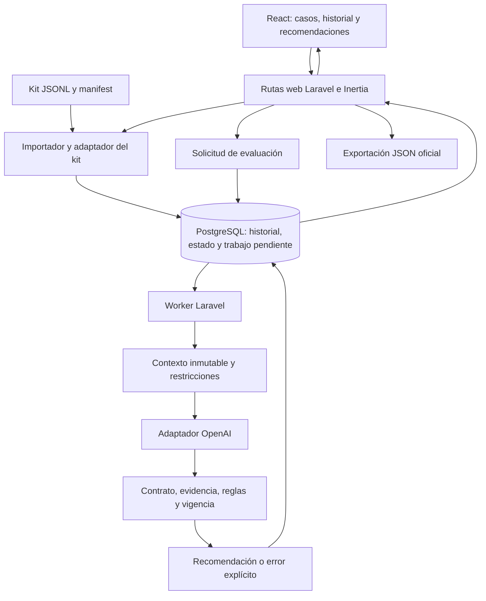

# 8. Arquitectura técnica

> Actualización de implementación — 10 de octubre de 2026: el stack base ya está inicializado. El usuario confirmó PostgreSQL alojado en Supabase, mediante Session pooler y esquema `byecode`, sin Docker. Autenticación y sesiones permanecen en Laravel. El hosting de Laravel y el modelo de IA siguen pendientes. Consultar `ESTADO_DESARROLLO.md` para distinguir lo implementado del diseño descrito a continuación.

**ByeCode · Diseño de implementación · Versión 1.0 · 10 de octubre de 2026.**

Este apartado convierte el [Modelo de IA](https://app.notion.com/p/3f5202c4d43080b1b308db5b105df1c5) y su flujo de información en una aplicación Laravel. El stack fue acordado con el usuario. Los módulos, tablas y rutas siguientes son decisiones de diseño propuestas; todavía no existe una aplicación implementada ni un despliegue verificado.

## 8.1. Arquitectura elegida

ByeCode será un **monolito modular Laravel con React e Inertia.js**, con navegación tipo SPA y un mismo repositorio. Laravel recibirá las solicitudes, controlará el estado y entregará a React las propiedades autorizadas de cada página. Inertia permite este modelo con rutas y controladores del servidor; el starter kit oficial integra React, TypeScript, Tailwind y shadcn/ui. [Documentación de Laravel](https://laravel.com/docs/13.x/starter-kits).

| Capa | Tecnología acordada | Responsabilidad en ByeCode |
|---|---|---|
| Backend | Laravel + PHP | Ingesta, sesiones, permisos, reglas, orquestación y publicación. |
| Frontend | React + TypeScript | Listado de casos, historial, explicación, estados y formularios. |
| Unión frontend/backend | Inertia.js | Navegación, envío de formularios y propiedades de página. |
| Construcción | Vite | Compilar los recursos del frontend. |
| Interfaz | Tailwind CSS + shadcn/ui | Componentes visuales y diseño consistente. |
| Persistencia | PostgreSQL + Eloquent | Eventos, estado, evaluaciones, recomendaciones y trazabilidad. |
| Procesamiento diferido | Jobs y colas de Laravel | Evaluaciones de IA y reintentos controlados. |
| IA | OpenAI API desde Laravel | Interpretación semántica y propuesta estructurada. |
| Pruebas del backend | Pest | Reglas, importación, persistencia, rutas y publicación. |

Las versiones concretas se fijarán en los archivos de dependencias al iniciar la implementación. El modelo de IA, sus límites de consumo y el proveedor de hosting permanecen pendientes. Next.js deja de formar parte de esta arquitectura; Supabase y Vercel no son dependencias confirmadas.

## 8.2. Alcance del prototipo y ampliaciones

El flujo mínimo del reto debe cargar el kit JSONL, agrupar casos, deduplicar eventos, interpretar mensajes mediante IA, aplicar R1–R6, conservar decisiones anteriores y exportar un array JSON. Un botón de evaluación es suficiente según el documento oficial. [Reto, pp. 1–3](<C:/Decisiones empresariales con IA/referencias/kit_publico/Reto_Byecode_Participantes_24h.pdf>).

| Entrega inicial | Ampliación del producto |
|---|---|
| Importación de `manifest.json`, `events.jsonl` y `updates.jsonl`. | Conectores autorizados de cotizaciones, CRM, almacén y producción. |
| Historial, métricas temporales y restricciones por caso. | Versiones de cotización, líneas, tallas, stock, capacidad y aceptaciones parciales. |
| Recomendación, evidencia, incertidumbre y comparación antes/después. | Ranking de cartera, revisión humana y feedback ampliado. |
| Exportación de los once campos oficiales. | Informes operativos y exportaciones adicionales con contratos separados. |

La especialización de prendas blank no debe alterar los casos oficiales: una pregunta sobre instalación o entrega se interpreta según su propio contexto. No se agregará información del nicho para completar artificialmente el kit.

## 8.3. Componentes y recorrido de una evaluación

1. El usuario carga un lote. El servidor valida cada línea y registra errores sin detener los demás casos válidos.
2. Una transacción registra cada evento nuevo, actualiza el estado y deja constancia duradera del trabajo pendiente. Una repetición idéntica no cambia métricas ni versiones.
3. Se solicita una evaluación y se devuelve la página con estado pendiente. La llamada al modelo se realiza en el worker.
4. El worker prepara una instantánea con eventos conocidos, hora de evaluación, reglas y versión del contexto. Calcula tiempos y alternativas preliminares en PHP.
5. El modelo interpreta los mensajes y devuelve una candidata. No tiene capacidad para enviar mensajes, modificar precios o cerrar casos.
6. El backend valida y vuelve a comprobar la vigencia antes de publicar. Conserva la candidata rechazada y sus errores cuando corresponda.
7. React consulta el estado actualizado mediante Inertia. La exportación utiliza exclusivamente recomendaciones válidas para el corte solicitado.

El estado comercial, el estado del trabajo y el estado de publicación son independientes: un trabajo fallido no significa una venta perdida, y una recomendación aprobada no significa una acción ejecutada.

## 8.4. Organización del backend

Los nombres siguientes son una propuesta para repartir responsabilidades y probarlas sin depender de la interfaz.

| Módulo o servicio propuesto | Entrada y salida | Responsabilidad principal |
|---|---|---|
| `ImportKit` / `OfficialKitAdapter` | Archivos → registros aceptados, duplicados y errores | Validar el perfil oficial y conservar procedencia y línea. |
| `ApplyCaseEvent` | Evento validado → nueva proyección | Aplicar parches, cierre terminal e idempotencia. |
| `BuildCaseContext` | Caso + reloj + corte de conocimiento → instantánea | Seleccionar evidencia y calcular métricas. |
| `EvaluateRules` | Instantánea → restricciones y alternativas | Implementar R1–R6 y compatibilidad temporal. |
| `EvaluateCaseJob` | ID de evaluación → resultado o fallo | Orquestar el proceso, sin lógica de UI. |
| `DecisionModel` / `OpenAIAdapter` | Contexto mínimo → candidata y señales | Aislar transporte, configuración y formato del proveedor. |
| `ValidateRecommendation` | Candidata + contexto → errores o validación | Revisar contrato, evidencia, reglas y coherencia. |
| `PublishRecommendation` | Resultado validado + versión esperada → publicación | Impedir que una respuesta antigua se convierta en vigente. |
| `ExportRecommendations` | Lote/corte autorizado → array oficial | Entregar solo los once campos y comprobar completitud. |
| `ReviewRecommendation` / `RecordFeedback` | Comando humano → registro auditable | Separar aprobación, opinión y ejecución real. Ampliación. |

Los controladores serán delgados: autorizar, validar la petición, invocar un servicio y responder con Inertia, redirección o descarga. Las reglas estarán en servicios de dominio compartidos por web, worker y pruebas. No se duplicarán en React ni se sustituirán por instrucciones en el prompt.

## 8.5. Perfil oficial y adaptación de contratos

La fuente de entrada del kit es `contratos.json`. Los esquemas internos del apartado 7 son contratos propios, con otra finalidad. **El esquema interno v1 no debe utilizarse directamente para rechazar eventos oficiales válidos.** La auditoría de los archivos públicos encontró estas diferencias:

| Aspecto | Kit público observado | Tratamiento de diseño |
|---|---|---|
| Acción realizada | `action.executed.data.action` | El adaptador lo convierte explícitamente a `action_type` si utiliza el contrato interno v1. Conserva el original. |
| Sección visualizada | `proposal.viewed.data.section` | Debe preservarse en el historial y contexto. El contrato interno v1 no la admite: se necesita una revisión explícita del esquema o un DTO específico del kit antes de integrarlo. |
| Valores iniciales | `contact_allowed=true`, `contact_not_before=null` | Aplicarlos en el perfil oficial porque están documentados, no porque el modelo los infiera. |
| Parche de restricciones | Solo cambia los campos incluidos | No reiniciar el resto del estado al recibir un parche parcial. |
| Anulación de fecha | El contrato oficial no declara un parche con fecha nula | No importar automáticamente la extensión interna que permite eliminar una fecha mediante `null`. |
| Cierre | `accepted`, `rejected` o `cancelled` | Son estados terminales del kit. Un mensaje posterior no los reabre. |
| Identidad y autoridad | Archivos sintéticos del reto | Su aceptación como fixture no les concede autoridad sobre datos productivos. |

La implementación inicial usará un DTO del perfil oficial y su mapeo a los servicios de dominio. Las ampliaciones empresariales podrán utilizar los sobres del apartado 7 después de resolver las incompatibilidades. No se borrará `section`, no se inventarán eventos y no se reemplazarán los archivos originales para hacer pasar una validación.

En el kit, `event_id` identifica el evento dentro de la ejecución completa, no solo dentro de un caso. En la aplicación, la unicidad se delimitará por empresa y conjunto de datos; un mismo ID con contenido distinto será un conflicto visible. Recargar el mismo lote conservará ese ámbito de deduplicación. Iniciar una ejecución de prueba independiente creará otro ámbito explícito.

## 8.6. Estado y semántica temporal

Se conservarán dos órdenes: la secuencia de entrada/aplicación y `occurred_at`. El kit se aplicará en el orden suministrado, preservando la línea para desempates; los cálculos de duración y la comparación de mensajes usarán sus fechas reales.

**P06 requiere especial cuidado:** `case.opened` ocurre a las 15:00 UTC, pero el contacto posterior en el archivo declara las 14:00 UTC. No se rechazará por ser anterior a la apertura, ni se ordenará todo ciegamente por fecha para aplicar el contacto a un caso aún inexistente. El importador conserva la secuencia y registra ese antecedente para el cómputo de R4.

| Tiempo | Uso |
|---|---|
| `occurred_at` | Momento comercial del evento. |
| `ingested_at` | Momento real de incorporación al sistema, escrito por el servidor. |
| `evaluation_at` | Momento del negocio que se está evaluando. En el kit procede de `manifest.json`: `2026-10-09T16:00:00Z`. |
| `knowledge_cutoff` o secuencia del lote | Información que estaba disponible en esa ejecución. Distingue el estado inicial de la actualización. |

La carga del kit puede ocurrir después de su fecha histórica. Por ello no se exigirá `ingested_at <= evaluation_at`; el corte de conocimiento se registra por separado. La primera evaluación excluye `updates.jsonl` porque aún no se cargó, aunque su mensaje tenga una fecha anterior a las 16:00. La segunda conserva la misma hora oficial e incorpora el nuevo conocimiento.

Todas las reglas calculan instantes en UTC. La UI puede mostrar la zona del usuario, indicando la conversión. R4 significa 24 horas transcurridas. El reloj será inyectable; la agenda y las pruebas usarán la misma referencia. El reloj fijo del kit no se expondrá como una opción libre para alterar permisos en operación real.

## 8.7. Almacenamiento y trazabilidad

PostgreSQL será la fuente persistente; Eloquent gestionará modelos y relaciones. Se usarán columnas tipadas para identidad, restricciones, fechas y estados; JSONB para payloads, contexto y trazas variables. Los importes se guardarán como centavos enteros o decimales exactos, con moneda explícita; no se utilizará coma flotante para cálculos monetarios.

| Grupo de tablas propuesto | Contenido mínimo |
|---|---|
| `import_batches`, `import_errors` | Fuente, hash, perfil, manifest, líneas y resultado de importación. |
| `case_events` | Evento original, normalizado cuando aplique, caso, secuencia y fechas. |
| `commercial_cases` | Proyección actual, restricciones, versión y referencia de recomendación vigente. |
| `context_snapshots` | Contexto inmutable usado, eventos incluidos, cortes y versiones. |
| `evaluations` | Estado, intentos, modelo, prompt, reglas, tiempos y error técnico. |
| `recommendations`, `recommendation_validations` | Objeto oficial, versión, evidencia, validación, procedencia y vigencia. |
| `outbox_jobs`, `jobs`, `failed_jobs`, `review_schedule` | Intención duradera, cola de ejecución, fallos y reevaluaciones pendientes. |
| `human_commands`, `feedback`, `audit_log` | Decisiones humanas y cambios autorizados; no prueban ejecución. |

Cotizaciones por versión, líneas, observaciones operativas y rankings serán tablas adicionales cuando se implemente esa ampliación. Las relaciones deberán permanecer en la misma empresa y conjunto de datos. Consultar un caso no concede acceso a todos los casos del cliente.

Se requieren claves únicas para deduplicación y para la publicación de una misma evaluación, claves foráneas, índices por caso/secuencia y estado/fecha de trabajo. El historial de recomendaciones se conserva; cambiar la vigente no sobrescribe la anterior. Los archivos originales se almacenan en un disco privado de Laravel, con acceso autorizado y política de conservación. Las copias de seguridad deben abarcar base y archivos, y probar su restauración antes de operación real.

## 8.8. Frontend, rutas web y significado de «sin API»

React tendrá páginas de importación, listado, detalle y comparación de decisiones. El detalle mostrará acción, timing, evidencia, explicación, confianza, riesgo, faltantes y restricciones. Los estados pendiente, en curso, fallido, obsoleto y pendiente de revisión serán visibles; ninguno se representará como `no_action` por defecto.

Todas las rutas siguientes son propuestas para `routes/web.php`, bajo sesión, autorización y protección CSRF en operaciones de escritura. La navegación y los formularios usarán Inertia.

| Método y ruta propuesta | Comportamiento |
|---|---|
| `GET /cases` | Listado Inertia con recomendaciones y estados. |
| `GET /cases/{case}` | Historial, contexto autorizado y comparación de versiones. |
| `GET /imports/create` | Formulario de carga del kit. |
| `POST /imports` | Procesar lote y redirigir al resultado con errores por línea. |
| `POST /cases/{case}/evaluations` | Crear trabajo idempotente y redirigir al caso. |
| `GET /evaluations/{evaluation}` | Página de seguimiento del trabajo. |
| `GET /exports/recommendations` | Descarga autorizada del array JSON oficial. |
| `POST /recommendations/{recommendation}/review` | Revisión humana con versión esperada, cuando se implemente. |
| `POST /recommendations/{recommendation}/feedback` | Registro de feedback, cuando se implemente. |

«Sin API» significa que no construiremos una API REST separada para conectar React y Laravel. Siguen existiendo solicitudes HTTP y respuestas del protocolo Inertia. La descarga JSON es un entregable del reto, y Laravel consume una API externa para la IA. Las rutas abstractas `/v1/...` del apartado 7.22 describían fronteras; no son una obligación de crear una segunda interfaz REST.

La UI podrá consultar periódicamente las propiedades del caso mientras una evaluación esté pendiente. El backend comprobará la vigencia en cada lectura; un intervalo de actualización visual no concede validez adicional a una recomendación vencida. Los mensajes se mostrarán como texto, evitando interpretar HTML suministrado por el comprador.

## 8.9. Modelo e integración externa

`OpenAIAdapter` recibirá una instantánea mínima, instrucciones versionadas, acciones preliminarmente admisibles y evidencia con IDs. Se propone consumir Responses API desde el cliente HTTP de Laravel. La clave vivirá en configuración del servidor; jamás se entregará mediante propiedades Inertia ni variables públicas de Vite.

La respuesta será estructurada. El esquema enviado al proveedor será específico para su subconjunto de JSON Schema: el esquema oficial local contiene condiciones `allOf/if/then/else` que no se pueden trasladar sin adaptación a Structured Outputs. Rechazos del modelo, respuestas incompletas y errores de formato tendrán tratamiento explícito. [OpenAI: Structured Outputs](https://developers.openai.com/api/docs/guides/structured-outputs?api-mode=responses).

El backend realizará después la validación completa del contrato y de la decisión. Un JSON estructuralmente correcto puede contener una interpretación errónea. Las señales semánticas conservarán evento y fragmento de origen; ambigüedades decisivas podrán requerir revisión humana.

El modelo concreto se elegirá con la batería del apartado 9, atendiendo a interpretación en español, condiciones y negaciones, evidencia, cumplimiento, latencia y consumo. El registro guardará el identificador efectivamente usado, parámetros admitidos, versión del prompt y resultados. No se declara todavía un costo, latencia o precisión alcanzados.

## 8.10. Validación de reglas y publicación

Las acciones dirigidas al comprador son `contact`, `request_information` y `resolve_objection`. Una fecha futura en `scheduled_for` no permite publicar hoy una acción bloqueada: se recomienda esperar y reevaluar cuando corresponda, conforme a la política conservadora del apartado 7.

| Regla | Control del backend | Resultado obligatorio |
|---|---|---|
| R1 | Estado terminal del caso | Solo `no_action` y `not_applicable`. |
| R2 | `contact_allowed=false` | Excluir las tres acciones de contacto. |
| R3 | `evaluation_at` anterior a `contact_not_before` | Excluir las mismas tres acciones. |
| R4 | Menos de 24 h desde el último `contact` o `request_information` ejecutado, sin mensaje estrictamente posterior | Bloquear un nuevo contacto. La excepción afecta solo a R4. |
| R5 | Fuentes y contenido de la explicación | Las aperturas aisladas no se convierten en compra, descuento, cierre o urgencia inmediata. |
| R6 | Datos esenciales y contenido propuesto | Declarar faltantes, mantener restricciones y no ejecutar contactos reales. |

R1–R4 y las relaciones de acción/timing tienen controles deterministas. R5, los faltantes y el sustento de una explicación también requieren evaluación semántica: comprobar IDs y buscar palabras no demuestra comprensión completa. Se combinarán señales con fuentes, reglas de construcción de texto, pruebas adversarias y revisión de ambigüedades. No se afirmará que una validación automática elimina todo error semántico.

El publicador comprobará exactamente los once campos: `case_id`, `action`, `timing`, `scheduled_for`, `reason`, `evidence_event_ids`, `confidence`, `confidence_reason`, `risk_level`, `requires_human_review` y `missing_information`. Las fechas deben ser válidas y coherentes; los IDs deben existir en el mismo caso y corte. La explicación no puede esconder una instrucción de contacto bajo `wait`, `no_action` o `escalate`.

Antes de publicar, una transacción corta comprobará la versión del caso, el corte, la política vigente y el vencimiento. Si cambiaron, la candidata se marca obsoleta. No se mantendrá un bloqueo de base de datos durante la llamada de red. La misma comprobación de vigencia se aplica al mostrar y exportar resultados.

Las recomendaciones que requieran revisión podrán mostrarse con una etiqueta de pendiente y su evidencia; no se presentarán como aprobadas. El JSON oficial conservará `requires_human_review`; exportarlo para evaluación del reto no constituye aprobación ni ejecución.

## 8.11. Colas, agenda y recuperación

Para el prototipo se propone el driver de cola en base de datos, un worker Laravel y una agenda de reevaluaciones. Laravel admite colas respaldadas por una base relacional y despacho tras confirmar una transacción. [Colas de Laravel](https://laravel.com/docs/13.x/queues).

El registro del evento y la intención de evaluarlo se persistirán juntos. Un despachador convertirá los registros pendientes de `outbox_jobs` en jobs idempotentes y recuperará los pendientes tras un reinicio. Usar solamente `afterCommit` no garantiza recuperar una intención si el proceso muere antes del despacho.

La agenda solicitará reevaluaciones al vencer una espera o una pausa de R4; nunca programará envíos reales. En modo kit, el botón de evaluación y el reloj fijo controlan el recorrido. En operación real, el scheduler procesa vencimientos y las lecturas impiden mostrar como vigente una recomendación ya caducada. [Programación de tareas de Laravel](https://laravel.com/docs/13.x/scheduling).

Cada evaluación tendrá un presupuesto de intentos y tiempo; los reintentos usarán la misma identidad lógica. Un timeout del proveedor no autoriza publicar una respuesta parcial ni garantiza que no hubo consumo. Se registrarán intentos y costos disponibles. El timeout del worker debe coordinarse con el timeout HTTP y la ventana de reintento para reducir ejecuciones solapadas.

Los fallos persistentes dejan un estado técnico visible y permiten reintento controlado. Si se produce una contingencia determinista sustentada, se identifica como tal. Por ejemplo, un caso cerrado conserva `no_action`; una espera conocida puede mantenerse. La contingencia no acredita funcionamiento del modelo.

## 8.12. Despliegue y seguridad práctica

La instalación necesita un servicio PHP/Laravel, PostgreSQL, recursos React compilados, almacenamiento privado y un worker. La agenda requiere un proceso programado cuando se active. El hosting deberá soportar estos componentes; aún no se selecciona proveedor.

Se propone partir de la autenticación del starter kit, sesiones y autorización por caso. El reto no exige autenticación, pero una instalación compartida debe impedir que una persona consulte o modifique información ajena. El ámbito de empresa se determina en el servidor; no se confía en un `tenant_id` enviado por el navegador.

Las importaciones tendrán límites de tamaño, tipo, filas y codificación; errores localizados y archivos privados. Las solicitudes del modelo contendrán únicamente datos sintéticos del kit o información autorizada y minimizada. El contenido del comprador no se ejecuta, no modifica instrucciones y no aporta credenciales.

Se observarán duplicados, errores de importación, bloqueos por regla, latencia, trabajos fallidos, respuestas obsoletas y consumo disponible. Los logs generales usarán identificadores de correlación y no copiarán mensajes completos ni secretos. Las pruebas de restauración y de reintentos deberán confirmar que no se duplican decisiones ni se disparan acciones externas.

## 8.13. Orden de implementación y decisiones pendientes

1. Importador oficial, perfil de datos, proyección y reloj del manifest.
2. Reglas R1–R6, contrato de salida y pruebas deterministas.
3. Páginas Inertia de listado/detalle y exportación JSON.
4. Adaptador OpenAI, worker, publicación con control de versión y pruebas semánticas.
5. Actualización P06, manejo de fallos, revisión completa y demo.
6. Ampliaciones de prendas, ranking y feedback después de estabilizar el flujo obligatorio.

Antes de declarar implementada esta arquitectura deben resolverse: la adaptación `action`/`action_type` y `section`, las versiones de dependencias, el modelo, los presupuestos de ejecución, la política de revisiones y el hosting. Las reglas comerciales del nicho siguen requiriendo fuentes autorizadas; esta especificación no inventa precios, capacidades o políticas de venta.

## 8.14. Fuentes y relación con otros apartados

- Decisión de stack del usuario del 10 de octubre de 2026, conservada en [AGENTS.md](<C:/Decisiones empresariales con IA/AGENTS.md>).
- [Modelo de IA, apartado 7](https://app.notion.com/p/3f5202c4d43080b1b308db5b105df1c5): interpretación, límites y contratos propios.
- [Kit público local](<C:/Decisiones empresariales con IA/referencias/kit_publico/README.txt>): contrato, eventos, actualización, políticas y ejemplo; copias sin cambios de los archivos suministrados.
- [Auditoría estática del kit](<C:/Decisiones empresariales con IA/ByeCode_09_Auditoria_kit_publico.json>): conteos, huellas e incompatibilidades verificadas.
- [Pruebas y evaluación, apartado 9](<C:/Decisiones empresariales con IA/ByeCode_09_Pruebas_y_evaluacion.md>): matriz y procedimiento de aceptación de esta arquitectura.
