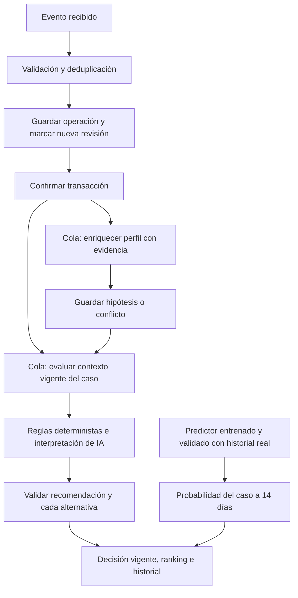

# ByeCode: decisiones por evento, perfil y ranking de acciones

Fecha: 10 de octubre de 2026. Especificación e implementación solicitadas por el usuario sobre Laravel, Inertia y React.

## 1. Fuente y alcance

Fuente principal: `Reto_Byecode_Participantes_24h.pdf`, facilitado por el usuario. Se revisaron sus cuatro páginas. Los apartados 2, 4, 5 y 6 definen la ingesta, las reglas y la recomendación; los apartados 7 y 8 definen entregables y evaluación. El PDF contiene una inconsistencia de duración: portada de 24 horas y pie/secuencia de 48 horas; esto no cambia los contratos funcionales.

El PDF exige interpretar mensajes, recomendar qué hacer, cuándo y por qué, distinguir hechos de inferencias y validar R1–R6 antes de publicar. Permite evaluar mediante un botón y no exige procesamiento continuo ni entrenamiento. Su `confidence` es cualitativa, no una probabilidad calibrada.

El usuario añade tres objetivos: actualizar automáticamente al recibir actividad, ordenar las acciones y disponer de porcentajes respaldados por datos reales. Se incorporan como extensiones sin modificar el kit público ni el JSON oficial de once campos.

| Necesidad                                                   | Procedencia                                | Resultado implementado / límite                                                                                                                       |
| ----------------------------------------------------------- | ------------------------------------------ | ----------------------------------------------------------------------------------------------------------------------------------------------------- |
| Ingesta por caso, deduplicación, UTC y reloj del manifiesto | PDF, pp. 1–2                               | Se conserva el adaptador existente y el kit sin cambios.                                                                                              |
| Una recomendación con acción, momento, motivo y evidencia   | PDF, p. 3                                  | Se conserva el contrato oficial y su validación determinista.                                                                                         |
| Actualización con eventos nuevos e historial anterior       | PDF, pp. 1 y 3                             | Se añade despacho inmediato en cola, invalidación por revisión y resumen de cambios.                                                                  |
| Procesamiento automático del perfil                         | Ampliación del proyecto                    | Cada actividad nueva asociada a cliente solicita enriquecimiento; lotes de hasta 30 eventos, con continuación automática al terminar un lote.         |
| Ranking de acciones                                         | Petición del usuario                       | El modelo propone el orden en la misma respuesta. Laravel comprueba cada alternativa y excluye las no sustentadas o bloqueadas.                       |
| Porcentaje de resultado del caso                            | Predictor existente + petición del usuario | Se mantiene la estimación experimental a 14 días, habilitada solo tras superar los controles del predictor. Se muestra la validación que la respalda. |
| Porcentaje de éxito atribuible a cada acción                | Petición del usuario                       | No existe un estimador validado de ese efecto. Se representa como no disponible; no se convierte el orden ni la confianza de GPT en porcentajes.      |

## 2. Flujo implementado

La transacción guarda primero el hecho. Solo después de confirmarse se despacha la evaluación. Si se revierte, no se publica el hecho ni se lanza su trabajo. La marca `next_review_at` permite recuperar el trabajo si falla el despacho; la agenda existente actúa como recuperación, no como el único disparador.

“Por evento” significa que cada evento nuevo relevante solicita revisar el contexto. Varias llegadas antes de que el worker procese un caso pueden compartir una evaluación del estado más reciente. El historial conserva todos los eventos. No se promete una llamada facturable por clic ni una respuesta instantánea: la cola, la disponibilidad del proveedor y los límites de presupuesto condicionan el tiempo.

## 3. Qué entradas producen cambios

| Entrada                                                                                                                                                       | Efecto                                                                                                                                                 |
| ------------------------------------------------------------------------------------------------------------------------------------------------------------- | ------------------------------------------------------------------------------------------------------------------------------------------------------ |
| Eventos comerciales aceptados por `ImportService` en modo live                                                                                                | Crea evaluación pendiente y solicita procesamiento inmediato del estado confirmado.                                                                    |
| Solicitud, conversación, publicación de cotización, decisión del comprador, asignación, pago/formalización/cancelación registrados mediante `CustomerJourney` | Invalidan la decisión del caso y solicitan evaluación y enriquecimiento del cliente. Pago, aceptación y cierre siguen siendo hechos diferentes.        |
| Navegación consentida de cliente con cuenta                                                                                                                   | Conserva origen `browser_unverified`; solicita revisión de sus casos abiertos y enriquecimiento. Un duplicado no cambia revisión ni despacha de nuevo. |
| Navegación anónima                                                                                                                                            | Se conserva con sesión, sin atribuirla a una persona hasta vincularla por el flujo existente. No puede generar decisiones de un cliente desconocido.   |
| Propiedad activa nueva o corregida                                                                                                                            | Invalida decisiones de los casos abiertos del cliente y solicita su actualización.                                                                     |
| Restricción temporal vencida o recomendación caducada                                                                                                         | La agenda recupera la revisión programada.                                                                                                             |
| Kit público                                                                                                                                                   | Conserva el reloj oficial y la evaluación explícita reproducible. No se convierte a reloj real.                                                        |

El contexto de actividad incluye las últimas 30 operaciones del caso y actividad sin caso del mismo cliente, con total y cantidad omitida. Los mensajes determinantes del caso mantienen el tratamiento existente: no se recortan silenciosamente para que quepa una llamada. Si se supera el límite de contexto, el procesamiento queda bloqueado con motivo visible. Una actividad adicional no se convierte en permiso de contacto ni en señal de intención confirmada.

Solicitudes y resultados comerciales también invalidan los otros casos abiertos del mismo cliente porque cambian los indicadores compartidos. Las evaluaciones pendientes de revisiones o configuraciones anteriores se marcan como sustituidas; no mantienen la interfaz en espera cuando ya existe una evaluación actual.

## 4. Papel de cada participante

| Participante            | Responsabilidad real                                                                                                                                                  |
| ----------------------- | --------------------------------------------------------------------------------------------------------------------------------------------------------------------- |
| Cliente (`customer`)    | Solicita productos, conversa, responde a cotizaciones y, con consentimiento, aporta actividad de navegación. No edita la clasificación del CRM.                       |
| Comercio (`commerce`)   | Opera cotizaciones y registra hechos comerciales; puede confirmar/corregir propiedades y revisar recomendaciones. No necesita pulsar analizar para cada evento nuevo. |
| Administrador (`admin`) | Consulta análisis y perfiles y crea cuentas de comercio. Sigue en modo lectura respecto al perfil comercial.                                                          |
| Laravel                 | Guarda hechos, valida evidencia, aplica reglas, controla vigencia y presupuesto, y conserva historial.                                                                |
| Modelo de lenguaje      | Interpreta texto, identifica faltantes e incertidumbre, propone hipótesis del perfil y ordena acciones. Su propuesta puede ser rechazada por Laravel.                 |
| Predictor local         | Estima el resultado del caso únicamente cuando existe un entrenamiento elegible; no envía mensajes ni autoriza acciones.                                              |

La confirmación humana sigue siendo opcional para corregir el perfil, pero necesaria para etiquetar una hipótesis como confirmada. Ninguna propuesta de IA reemplaza una corrección humana vigente. Aprobar una recomendación no ejecuta un contacto.

## 5. Ranking y contrato de salida

La respuesta interna del modelo incorpora `action_order`: exactamente las seis acciones del catálogo, sin duplicados, comenzando por la elegida en `action`. No incorpora porcentajes ni puntuaciones. Se utiliza `byecode_semantic_v2` y la versión de prompt `byecode-semantic-2.0`; las interpretaciones antiguas no se reutilizan como respuestas del contrato nuevo.

Laravel valida por separado:

1. Que la primera acción y sus citas pertenezcan al caso y tengan respaldo literal.
2. Que R1–R6 y las preferencias del comprador permitan la acción.
3. Que las acciones alternativas tengan el respaldo exigido: pregunta/objeción, interés explícito o faltante que deba aportar el comprador, según corresponda.
4. Que faltantes internos no se conviertan en contacto al comprador.
5. Que momento y fecha sean compatibles con las restricciones.

Las acciones admisibles reciben posiciones consecutivas. Las bloqueadas o sin respaldo conservan `rank: null` y un motivo. Para decisiones resueltas por reglas, solo se prioriza la acción sustentada; no se simula una interpretación adicional de IA.

Cada alternativa almacena acción, posición, motivo, evidencia, momento, fecha, origen, selección y revisión humana. `probability` permanece nula y `probability_status` indica que no se estima el éxito por acción. Las alternativas usan el JSON ya existente de `recommendations`; no hay migración nueva.

El ranking es prioridad de intervención, no una distribución de probabilidades. No se normaliza para sumar 100 %. La exportación oficial conserva exactamente sus once campos: `case_id`, `action`, `timing`, `scheduled_for`, `reason`, `evidence_event_ids`, `confidence`, `confidence_reason`, `risk_level`, `requires_human_review` y `missing_information`.

## 6. Qué significa un porcentaje real en este proyecto

El predictor existente estima cierre registrado como aceptado durante los siguientes 14 días desde el corte. Esa etiqueta no equivale por sí sola a pago cobrado. Es una estimación experimental, no una garantía ni una medida del efecto causal de una acción.

Sus controles actuales se conservan: historial declarado real, al menos 200 casos maduros; particiones temporales con purga por cliente, mínimo 100/30/30 filas y 10 resultados de cada clase en cada partición; calibración y prueba separadas; Brier mejor que la referencia, AUC de al menos 0.65 y ECE de hasta 0.15. También bloquea kit sintético, casos no elegibles, extrapolación evidente y entrenamientos de más de 30 días. Los umbrales son criterios iniciales del proyecto, no certificación comercial.

La pantalla muestra el porcentaje solamente cuando `PredictionService` lo habilita, acompañado por identificador y fecha de evaluación, número de casos de prueba y métricas. En caso contrario muestra “Porcentaje no disponible” y la causa; nunca `0 %` como sustituto de un dato desconocido.

Para estimar “éxito si elijo esta acción” faltaría definir y recolectar el resultado objetivo, el horizonte, la acción efectivamente ejecutada, la exposición a alternativas, el contexto previo y los factores que influyen en elegir cada acción. También haría falta validar esa estimación por acción y estudiar el sesgo de selección. No basta reutilizar la probabilidad general del caso en todas las filas. Este estimador por acción no está implementado ni validado en esta entrega.

## 7. Actualización, errores y costos

- Los trabajos leen la revisión más reciente confirmada. Una respuesta que termine después de un cambio de revisión no se publica como vigente.
- La deduplicación evita repetir trabajo por el mismo evento; las llamadas repetidas sobre una evaluación completada no consumen de nuevo.
- El perfil continúa automáticamente un lote completado cuando quedan eventos. Un lote fallido no se omite ni se repite automáticamente; conserva el reintento explícito limitado.
- Las reglas deterministas pueden resolver casos sin consultar IA. Sin clave, un caso que necesita interpretación queda bloqueado explícitamente.
- Los límites existentes se mantienen: 22 MXN/24 h, 160 MXN/7 días y 200 llamadas/24 h. No se modifica modelo, tarifa, política de reservas ni escalamiento.
- La recuperación programada se conserva: decisiones cada minuto y recuperación de perfiles cada cinco minutos. Requiere worker y agenda activos.
- Las pantallas de caso y perfil consultan cambios cada diez segundos mientras la pestaña está visible. Esto consulta Laravel; no invoca OpenAI desde el navegador.
- El detalle conserva decisiones anteriores y muestra el cambio de acción, los eventos nuevos y la actividad nueva incluida en el contexto.

## 8. Mapa de implementación

| Área                                 | Archivos principales                                                                          |
| ------------------------------------ | --------------------------------------------------------------------------------------------- |
| Disparo después de confirmar datos   | `app/Domain/Evaluation/DecisionUpdates.php`, `app/Jobs/RefreshCaseDecision.php`               |
| Entradas comerciales y navegación    | `ImportService.php`, `CustomerJourney.php`, `TelemetryController.php`                         |
| Perfil automático y continuación     | `CustomerProfile.php`, `EnrichCustomer.php`                                                   |
| Contexto, interpretación y vigencia  | `CaseProjector.php`, `SemanticContract.php`, `DecisionValidator.php`, `EvaluationService.php` |
| Ranking validado                     | `app/Domain/Decision/ActionRanking.php`                                                       |
| Porcentaje y evidencia de validación | `PredictionService.php`, `case-detail.tsx`                                                    |
| Presentación                         | `recommendation-panel.tsx`, `journey/profile.tsx`                                             |
| Regresión del flujo nuevo            | `tests/Feature/ByeCode/EventDrivenDecisionTest.php`                                           |

Se usa la cola de base de datos en las pruebas SQLite para representar el procesamiento asíncrono; las pruebas del worker lo ejecutan de forma controlada. Las llamadas de IA se simulan y se prohíben solicitudes HTTP imprevistas.

## 9. Criterios de aceptación

- Confirmar un evento nuevo solicita evaluación sin pulsar un botón; un rollback no despacha.
- Un pago sin cierre actualiza contexto y recomendación, manteniendo abierta la oportunidad.
- Una ráfaga usa el contexto vigente y no publica una respuesta de revisión anterior.
- El mismo `event_id` no incrementa revisión ni vuelve a solicitar procesamiento.
- R1–R4 excluyen del ranking las acciones prohibidas; ausencia de evidencia impide priorizar contacto.
- El contrato oficial exportado sigue teniendo once campos y evidencia del mismo caso.
- La confianza y el orden nunca se presentan como probabilidad.
- Sin entrenamiento elegible se muestra una causa, no un porcentaje inventado.
- Los fallos de IA son visibles; no se confunden con una decisión comercial de no intervenir.
- Se conservan los roles, correcciones humanas, presupuesto, kit, credenciales locales y datos del negocio.

## 10. Operación pendiente

Esta entrega implementa y prueba el flujo de software con respuestas simuladas. La calidad semántica debe medirse con el procedimiento explícito existente de evaluación real, y las probabilidades requieren historial real elegible. No se realizaron llamadas facturables ni entrenamiento que habilite porcentajes comerciales como parte de estos cambios.
