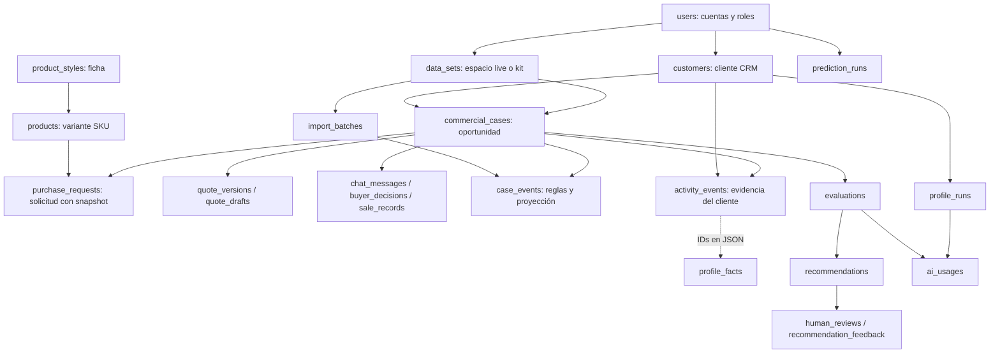

# ByeCode: estructura de datos para preparar seeders en JupyterLab

Fecha de corte: 10 de octubre de 2026. Contrato obtenido del código y las migraciones locales vigentes. Este documento describe la estructura existente y propone la organización de los archivos de entrega; **no implementa seeders, no ejecuta cargas y no certifica el estado de una base remota**.

## 1. Qué debe entregar quien prepara los datos

Preparar un paquete reproducible de datos sintéticos para desarrollo/pruebas. JupyterLab genera y valida los archivos; Laravel debe encargarse de materializar las operaciones que modifican varios historiales. No existe todavía un importador general para el paquete propuesto aquí. El importador de eventos existente acepta JSONL de eventos de casos; no importa por sí solo cuentas, catálogo, CRM, pagos ni perfiles.

El paquete debe incluir:

1. `manifest.json`: versión del paquete, `data_kind: "synthetic"`, semilla aleatoria, reloj de referencia UTC, escenarios, cantidades y hashes SHA-256 de los archivos.
2. Archivos JSONL por entidad/operación, con una clave externa estable `seed_key` y referencias `*_key`. Estas claves pertenecen al paquete, **no son columnas nuevas de la base**.
3. `id_map.json`: mapa producido por el futuro cargador entre claves externas e IDs asignados por Laravel. No se presupone que el administrador ni el primer cliente tengan ID 1.
4. `validation_report.json`: referencias resueltas, duplicados, cálculos, secuencia temporal y escenarios verificados; errores separados de advertencias.
5. `README.md`: orden de ejecución, dependencias, reloj usado, volúmenes y procedencia sintética.
6. Adjuntos opcionales en `assets/`, con nombre, MIME, tamaño y hash. Una ruta en una fila no crea el archivo físico.

Usar UTF-8, JSON real para estructuras anidadas, fechas ISO UTC terminadas en `Z`, booleanos JSON y enteros para cantidades/centavos. Si se usan DataFrames, convertir `NaN`, `NaT` y tipos NumPy antes de exportar. `null`, cadena vacía, cero y ausencia no son equivalentes. Ordenar los archivos explícitamente; la posición accidental del DataFrame no debe determinar la historia.

## 2. Alcance funcional y mapa de relaciones



Las referencias dentro de JSON y los números de versión no siempre tienen FK SQL. El generador/cargador debe validarlos igualmente. `account_id` representa la cuenta compradora; `user_id` en clientes, productos y espacios representa su propietario/creador comercial. No son intercambiables.

## 3. Organización propuesta de notebooks y carga

Los nombres siguientes son una propuesta de entrega, no archivos ya implementados.

| Orden | Notebook / archivo de salida                                | Responsabilidad                                                                                      |
| ----- | ----------------------------------------------------------- | ---------------------------------------------------------------------------------------------------- |
| 00    | `00_configuracion.ipynb` / `manifest.json`                  | Semilla, reloj, volúmenes, escenarios, claves externas; sin credenciales                             |
| 01    | `01_cuentas.ipynb` / `users.jsonl`                          | Comercios y compradores; preservar administrador existente                                           |
| 02    | `02_catalogo.ipynb` / `styles.jsonl`, `variants.jsonl`      | Fichas y variantes publicadas/no publicadas                                                          |
| 03    | `03_solicitudes.ipynb` / `requests.jsonl`                   | Primera solicitud crea cliente CRM; posteriores lo reutilizan; espacio live y caso por solicitud     |
| 04    | `04_cotizaciones.ipynb` / `quote_operations.jsonl`          | Borradores, publicación de versiones y retiros                                                       |
| 05    | `05_conversaciones.ipynb` / `conversation_operations.jsonl` | Mensajes, adjuntos y decisiones del comprador                                                        |
| 06    | `06_resultados.ipynb` / `sale_operations.jsonl`             | Formalizaciones, pagos, cancelaciones/rechazos y cierre explícito                                    |
| 07    | `07_actividad.ipynb` / `activity_events.jsonl`              | Evidencia adicional y navegación sintética consentida; no duplicar eventos generados por operaciones |
| 08    | `08_perfiles.ipynb` / `profile_operations.jsonl`            | Siete dimensiones, necesidades particulares, correcciones y conflictos                               |
| 09    | `09_reglas.ipynb` / `business_events.jsonl`                 | Casos controlados para R1–R6; kit oficial separado e intacto                                         |
| 10    | `10_analitica.ipynb` / `prediction.csv`                     | Muestra sintética opcional para laboratorio, sin habilitar uso comercial                             |
| 11    | `11_validacion.ipynb` / `validation_report.json`            | Integridad, importes, cronología, idempotencia y cobertura                                           |

Los notebooks 04–08 pueden producir operaciones intercaladas: **el cargador debe ejecutarlas por la cronología de cada escenario**, no crear todos los pagos antes de todos los mensajes. Las dependencias mandan: evidencia antes de perfil, versión antes de decisión, cliente/caso antes de actividad.

Orden físico de dependencias si se construye un cargador de fixtures: `users` → `product_styles`, `data_sets`, `customers` → `products`, `commercial_cases` → `purchase_requests`, `quote_drafts`, `quote_versions`, `import_batches` → `case_events`, `chat_messages`, `buyer_decisions`, `sale_records`, `activity_events` → `profile_facts` → registros derivados opcionales. La ruta preferida para solicitudes es `CustomerJourney::submit`, que crea conjuntamente cliente/caso/solicitud/eventos.

## 4. Convenciones del diccionario

`?` indica nullable en la base. `JSON` corresponde a JSONB en PostgreSQL. Salvo que se indique otra cosa, `id` es entero autogenerado. `TS` significa `created_at` y `updated_at`; las tablas de dominio usan timestamps con zona. En campos de texto sin longitud indicada rige la migración y puede existir una validación de aplicación más estricta.

**Que una columna admita un valor no significa que la operación sea válida.** Las restricciones de negocio adicionales se describen después de cada grupo. No todas las listas de estados son enums SQL.

### 4.1 Cuentas, propiedad y clientes

| Tabla       | Campos actuales                                                                                                                                                                                                                                             | Claves / uso                                                                                                                    |
| ----------- | ----------------------------------------------------------------------------------------------------------------------------------------------------------------------------------------------------------------------------------------------------------- | ------------------------------------------------------------------------------------------------------------------------------- |
| `users`     | `id`, `name`, `email`, `email_verified_at?`, `password`, `remember_token?`, TS, `two_factor_secret?`, `two_factor_recovery_codes?`, `two_factor_confirmed_at?`, `role` (default customer), `must_change_password` (false), `temporary_password_expires_at?` | Email único. Roles: `admin`, `commerce`, `customer`. Password con hash Laravel; 2FA y tokens no se rellenan con texto inventado |
| `data_sets` | `id`, `user_id`, `name`, `mode`, `evaluation_at?`, `integrity_blocked` (false), TS                                                                                                                                                                          | FK usuario. Modos `live`/`kit`. Índice único parcial: un live por usuario                                                       |
| `customers` | `id`, `user_id`, `account_id?`, `company`, `contact_name?`, `email?`, `notes?`, TS                                                                                                                                                                          | `account_id` FK users y único. Un comprador tiene como máximo un cliente CRM; puede tener muchas oportunidades                  |

El administrador consulta análisis y crea comercios. Comercio opera catálogo/CRM compartidos; kits e importaciones conservan propietario. Registro público crea `customer`. Tener cuenta no crea automáticamente cliente CRM: lo crea la primera solicitud. La captura presencial para correos nuevos tiene acceso temporal de 24 h y cambio obligatorio; nunca restablece una cuenta existente. Para fixtures usar cuentas de prueba y correos `example.test`; el administrador existente no se regenera.

### 4.2 Catálogo: estilo y variante

| Tabla            | Campos actuales                                                                                                                                                                                                        | Claves / uso                                                                                                                                 |
| ---------------- | ---------------------------------------------------------------------------------------------------------------------------------------------------------------------------------------------------------------------- | -------------------------------------------------------------------------------------------------------------------------------------------- |
| `product_styles` | `id`, `name`, `category`, `details` JSON, `published` (false), TS                                                                                                                                                      | Una ficha contiene varias variantes                                                                                                          |
| `products`       | `id`, `user_id`, `style_id?`, `sku`, `name`, `category`, `fit?`, `gsm?`, `composition?`, `color?`, `size?`, `unit_price_cents?`, `moq?`, `stock?`, `verified_at?`, `source?`, `details?` JSON, `published` (false), TS | FK usuario/estilo. SQL único `(user_id, sku)`; aplicación actual exige además SKU global y combinación `(style_id, fit, color, size)` únicos |

`product_styles.details`: `description` (hasta 5000), `fabric` (1000), `construction` (2000), `care` (1000), `fit_guide` (4000), `size_guide` (4000), `photos` (array obligatorio, 0–8 URLs HTTPS, cada una hasta 1000). Los textos son nullable.

`products.details`: `color_code` (80), `measurements` (1000), `tolerance` (500), `availability` (500); textos nullable. Alta actual de variante exige `style_id`, `sku`, `fit`, `color`, `size`, `source`, `published`, `details`; `name/category` se copian del estilo. `gsm` 1–1500, `moq` ≥1, `stock` ≥0, todos desconocidos pueden ser null. El precio interno no se publica en catálogo. No deducir existencias/precios de una foto. Publicación exige estilo y variante publicados. Las cantidades de stock son observaciones, no reservas ni confirmación de surtido.

### 4.3 Solicitudes y oportunidades

| Tabla               | Campos actuales                                                                                                                                                                                                                                                                  | Claves / uso                                                                                                  |
| ------------------- | -------------------------------------------------------------------------------------------------------------------------------------------------------------------------------------------------------------------------------------------------------------------------------- | ------------------------------------------------------------------------------------------------------------- |
| `commercial_cases`  | `id`, `data_set_id`, `customer_id?`, `assigned_to?`, `public_id?` UUID, `external_id`, `title`, `status` (open), `stage` (proposal_sent), `revision` (0), `amount_cents?` (null), `integrity_blocked` (false), `next_review_at?`, `portal_token_hash?`, `portal_expires_at?`, TS | Únicos `(data_set_id, external_id)`, `public_id`, `portal_token_hash`. Responsable opcional debe ser comercio |
| `purchase_requests` | `id`, `account_id`, `commercial_case_id`, `submission_id` UUID, `lines` JSON, `message?`, `desired_date?` fecha, `source`, TS                                                                                                                                                    | Un caso por solicitud; `commercial_case_id` y `submission_id` únicos. Cuenta compradora del cliente           |

Estados de caso: `open`, `accepted`, `rejected`, `cancelled`. Etapas proyectadas: `request_received`, `proposal_sent`, `proposal_viewed`, `conversation`, `closed`. Estado/etapa/revisión/importe son proyecciones del historial, no categorías aleatorias independientes. Los campos de portal anónimo son legado: dejarlos null; el acceso vigente es cuenta autenticada y `public_id` estable.

Entrada de solicitud: `submission_id`, `company?` (180 caracteres), `message?` (8000), `desired_date?`, `lines:[{product_id,quantity}]`. De 1 a 30 líneas, productos distintos, cantidad 1–1 000 000; variante publicada y estilo publicado. La captura presencial requiere además `name` y `email` (hasta 180). La fecha deseada se valida como fecha actual o futura al enviar. `source`: `self_service` o `physical`.

Snapshot persistido de cada línea: `product_id, sku, name, fit, gsm, composition, color, size, quantity, below_moq`. **No lleva precio.** `below_moq` se calcula contra MOQ conocido y no impide solicitar; es información para revisión.

### 4.4 Cotizaciones versionadas y borradores

| Tabla            | Campos actuales                                                                                                                                                                                                                      | Claves / uso                                                                  |
| ---------------- | ------------------------------------------------------------------------------------------------------------------------------------------------------------------------------------------------------------------------------------ | ----------------------------------------------------------------------------- |
| `quote_drafts`   | `id`, `commercial_case_id`, `payload` JSON, `revision` (1), TS                                                                                                                                                                       | Caso único; borrador interno, no visible al comprador                         |
| `quote_versions` | `id`, `commercial_case_id`, `version`, `lines` JSON, `subtotal_cents`, `tax_cents` (0), `shipping_cents` (0), `discount_cents` (0), `total_cents`, `terms?`, `authorization_reference`, `valid_until`, `created_at`, `withdrawn_at?` | Único `(commercial_case_id, version)`; empieza en 1 y aumenta. Sin updated_at |

Payload de borrador: `draft_revision, expected_revision, customer_id, title?, valid_until?, terms?, authorization_reference?, tax?, shipping?, discount?, lines`. Sus líneas son campos editables **string/nullable**: `product_id, quantity, unit_price, supply_mode, stock_units`; puede estar incompleto. No reutilizar este formato como snapshot de versión publicada.

Entrada de publicación: mismos datos comerciales, con `title`, vigencia futura, referencia de autorización (5–1000 caracteres), `tax/shipping/discount` en MXN decimal hasta 2 decimales, 1–30 líneas completas, revisiones esperadas correctas. La vigencia de fecha local se convierte a final del día en America/Mexico_City y luego UTC.

Línea publicada contiene: `line_id` (`L1`, `L2`…), `product_id`, `sku`, `name`, `category`, `fit`, `gsm`, `composition`, `color`, `size`, `quantity`, `unit_price_cents`, `total_cents`, `supply_mode`, `stock_units`, `manufacture_units`, `observed_stock`, `stock_verified_at`, `moq`, `below_moq`, `fulfillment_confirmed` (false).

- `supply_mode=stock`: `stock_units=quantity`.
- `manufacture`: `stock_units=0`.
- `mixed`: `0 < stock_units < quantity`.
- `manufacture_units=quantity-stock_units`; stock asignado no supera existencias si son conocidas.
- Total de línea = cantidad × precio unitario. Subtotal = suma de líneas. Total = subtotal + impuesto + envío − descuento; descuento no supera subtotal + impuesto + envío.
- Importes persistidos en centavos enteros; máximo operativo total 999999999999 centavos. Evitar float de Python para dinero; generar enteros o Decimal.
- Publicar genera eventos en ambos historiales y elimina el borrador. Retirar marca `withdrawn_at`, conserva la versión e invalida su uso. No modificar retrospectivamente el snapshot porque cambió el catálogo.

### 4.5 Conversación, decisiones y resultados

| Tabla             | Campos actuales                                                                                                                                               | Claves / uso                                                               |
| ----------------- | ------------------------------------------------------------------------------------------------------------------------------------------------------------- | -------------------------------------------------------------------------- |
| `chat_messages`   | `id`, `event_id` UUID único, `commercial_case_id`, `author_id`, `author_role`, `body`, `quote_version?`, `attachment_path?`, `attachment_name?`, `created_at` | Autor real del mensaje; versión del mismo caso si existe                   |
| `buyer_decisions` | `id`, `event_id` UUID único, `commercial_case_id`, `account_id`, `quote_version`, `kind`, `lines` JSON, `conditions?`, `created_at`                           | Cuenta compradora del caso. `kind`: `accept`, `reject`, `change`           |
| `sale_records`    | `id`, `event_id` UUID único, `commercial_case_id`, `author_id`, `kind`, `amount_cents?`, `reference`, `occurred_at`, `created_at`                             | Comercio registra hechos: `formalized`, `payment`, `cancelled`, `rejected` |

Mensaje: cuerpo 1–8000 caracteres; adjunto opcional JPG/JPEG/PNG/WebP/PDF hasta 5120 KB en almacenamiento privado Laravel. El mensaje del comprador genera `message.received`; el comercial genera `action.executed` con `action=contact` y referencia `chat:<uuid>`, además de `message.sent` en actividad. No crear esos reflejos por duplicado.

Decisión: `lines:[{line_id,quantity}]`, 1–30 líneas, IDs distintos existentes en la versión, cantidad 0–cantidad cotizada; aceptar exige al menos una unidad. Solo la última versión vigente/no retirada de un caso abierto. `conditions` hasta 4000 caracteres. Puede ser parcial o condicionada: **aceptar no equivale a formalizar, pagar o cerrar**.

Resultado: `reference` 5–2000 caracteres, fecha no futura; `formalized/payment` requieren importe (la validación actual permite cero). Pago parcial y varios pagos se suman como movimientos, no como saldo acumulado repetido. En la operación `close` es un booleano de entrada, **no columna**: si true añade `case.closed`; formalized/payment cierran como accepted, cancelled/rejected con el estado correspondiente. No existe tabla separada de facturas, envíos, reservas de inventario ni reembolsos.

### 4.6 Historial de casos e importaciones

| Tabla            | Campos actuales                                                                                                                                                                                | Claves / uso                                                                               |
| ---------------- | ---------------------------------------------------------------------------------------------------------------------------------------------------------------------------------------------- | ------------------------------------------------------------------------------------------ |
| `import_batches` | `id`, `data_set_id`, `name`, `profile`, `sha256`, `path?`, `accepted` (0), `duplicates` (0), `errors` JSON, TS                                                                                 | Metadatos del importador; generar a través de ImportService                                |
| `case_events`    | `id`, `data_set_id`, `commercial_case_id`, `import_batch_id?`, `event_id`, `event_type`, `occurred_at`, `ingested_at`, `line_number?`, `profile`, `payload_hash`, `original` JSON, `data` JSON | Único `(data_set_id,event_id)`; no TS convencionales. Original y normalizado son distintos |

Formato JSONL de entrada existente: un objeto por línea, **solo** `event_id, case_id, event_type, occurred_at, data`. IDs de entrada de 1–120 caracteres con patrón `[a-zA-Z0-9][a-zA-Z0-9_.:-]*`. `case_id` corresponde a `external_id`, no al ID entero. No añadir `seed_key` dentro del JSONL que recibe este importador; el mapa del paquete se guarda aparte.

| Tipo                   | `data` admitido                                                                                                             |
| ---------------------- | --------------------------------------------------------------------------------------------------------------------------- |
| `case.opened`          | `{status:"open", proposal_amount_mxn:numero}`; business-v1 admite null si aún no se cotiza                                  |
| `proposal.viewed`      | `{section:"texto"}` hasta 100 caracteres                                                                                    |
| `message.received`     | `{message:"texto"}` hasta 8000                                                                                              |
| `action.executed`      | `{action:"contact" o "request_information", execution_reference:"texto"}`; referencia obligatoria solo business-v1          |
| `constraint.updated`   | Parche no vacío: `contact_allowed:boolean` y/o `contact_not_before:UTC`; business-v1 permite null para retirar fecha mínima |
| `case.closed`          | `{status:"accepted" o "rejected" o "cancelled"}`                                                                            |
| `quote.published`      | `{version:entero>=1,total_cents:entero>=0}`; solo business-v1                                                               |
| `observation.recorded` | `{topic,note,source,verified_until:UTC}`; solo business-v1                                                                  |

Perfiles: `business-v1` y `official-kit-v1`. El adaptador añade `amount_cents` y `action_type` al normalizado; **la entrada sigue usando `proposal_amount_mxn` y `action`**. Los campos desconocidos se rechazan. `proposal.viewed.section` debe conservarse.

Ejemplo válido para business-v1:

```json
{
    "event_id": "DEMO-001-e1",
    "case_id": "DEMO-001",
    "event_type": "case.opened",
    "occurred_at": "2026-10-01T16:00:00Z",
    "data": { "status": "open", "proposal_amount_mxn": null }
}
```

No generar hashes ni revisiones con otra normalización: el importador calcula identidad, deduplicación, conflictos y proyección. Repetir identidad con contenido distinto no es un update ordinario. El kit en `referencias/kit_publico` se conserva sin cambios, con su reloj oficial `2026-10-09T16:00:00Z`; P06 contiene contacto previo a apertura que se preserva para R4. No mezclar sus datos sintéticos con historial real.

Los defaults de restricciones son `contact_allowed=true` y `contact_not_before=null`. No se guardan como columnas en commercial_cases: se reconstruyen con los eventos. El orden de proyección es el de ingesta/ID, considerando el corte temporal; no reordenar retrospectivamente el historial solo por occurred_at.

### 4.7 Actividad del cliente y telemetría

`activity_events`: `id`, `event_id` UUID único, `account_id?`, `customer_id?`, `commercial_case_id?`, `session_key?`, `type`, `actor`, `source`, `schema_version` (1), `data` JSON, `occurred_at`, `ingested_at`. No created_at/updated_at. Las FK de cuenta/cliente/caso deben ser coherentes entre sí.

Actividad operacional usa `source=application`, `actor=customer/commerce/system` según quien realiza el hecho. Incluye `request.submitted`, `message.received`, `message.sent`, `quote.published`, `quote.withdrawn`, `case.assigned`, `buyer.accept/reject/change`, `sale.formalized/payment/cancelled/rejected`, eventos comerciales registrados y revisión/feedback. El campo `account_id` es la cuenta del cliente, no necesariamente el autor comercial; `actor` indica su rol. En muchos casos se reutiliza el UUID de la operación en tablas distintas: eso es correcto porque cada tabla tiene su propia unicidad.

Navegación: `source=browser_unverified`, `actor=visitor` o `customer`, sesión analítica propia; cuenta/cliente/caso pueden ser null según el contexto. No confundir `session_key` con la sesión de autenticación. La operación real exige consentimiento y máximo 50 eventos por envío. Para pruebas, consignar consentimiento sintético en el escenario; no inventar una columna de consentimiento.

Tipos de navegación admitidos:

```text
catalog.search, catalog.filter, catalog.product_opened,
catalog.variant_selected, catalog.quantity_changed,
ui.session_started, ui.section_visible, ui.section_visibility_duration,
ui.scroll_depth_reached, ui.section_expanded, ui.fit_details_opened,
ui.fabric_details_opened, ui.version_comparison_opened,
ui.change_request_started, ui.response_cta_clicked,
proposal.viewed, proposal.version_viewed, proposal.print_clicked,
ux.repeated_click, ux.form_validation_failed, ux.api_error, ux.loading_timeout
```

`data` permite únicamente: `section?` y `element?` (80 caracteres), `query?` (120), `filter?` (80), `product_id?`, `quantity?` (0–1 000 000), `version?` (≥1), `duration_ms?` (0–30000), `depth?` (0–100). No todas las claves aplican a todos los tipos. Producto y versión deben existir y pertenecer al contexto adecuado.

La telemetría no crea automáticamente un `case_event` homónimo. Una vista en activity_events no debe duplicarse a case_events sin una operación explícita del escenario. La navegación no prueba lectura, intención, pago ni aceptación.

### 4.8 Perfil comercial y propiedades evolutivas

`profile_facts`: `id`, `customer_id`, `name`, `scope`, `value` JSON, `nature`, `confidence?`, `evidence` JSON, `status` (active), `model?`, `processor_version`, `supersedes_id?`, `observed_at`, `valid_until?`, `created_at`.

- `nature`: `confirmed` (confirmación humana) o `inferred` (hipótesis).
- `confidence`: `low`, `medium`, `high`; requerido por el servicio aunque la columna sea nullable. No es porcentaje de compra.
- `status`: `active`, `superseded`, `conflicting`.
- `evidence`: array de 1–20 IDs enteros de **activity_events del mismo cliente**, con actor distinto de ai. No son UUID ni IDs de case_events.
- Servicio de escritura recibe `value_json` como texto JSON; almacena ese JSON en `value`. `name/scope` hasta 120, JSON hasta 4000 caracteres. Versión actual `customer-profile-v2`.
- Una nueva confirmación sustituye la vigente de igual nombre/alcance y preserva historial. Una inferencia frente a una confirmación se registra como conflicto. `supersedes_id` es referencia lógica, sin FK declarada.
- Las dimensiones comerciales usan `scope="cliente"`; desconocido es ausencia o **valor JSON null**, no cadena `"null"`, categoría `unknown` o cero.

| `name`                               | Tipo de valor y opciones exactas                                                                                                                                                      |
| ------------------------------------ | ------------------------------------------------------------------------------------------------------------------------------------------------------------------------------------- |
| `commercial.business_type`           | string: `own_brand`, `reseller`, `distributor`, `uniforms`, `events`, `other`                                                                                                         |
| `commercial.operating_scale`         | string: `individual`, `single_site_team`, `multi_site`, `corporate_group`                                                                                                             |
| `commercial.purchase_frequency`      | string: `one_off`, `seasonal`, `recurring`, `supply_program`                                                                                                                          |
| `commercial.buying_process`          | string: `direct`, `multiple_approvals`, `procurement`, `tender`                                                                                                                       |
| `commercial.priorities`              | array no vacío, sin repetidos: `price`, `quality`, `deadline`, `continuity`, `flexibility`, `customization`                                                                           |
| `commercial.service_requirements`    | array no vacío, sin repetidos: `samples`, `supplier_approval`, `quality_traceability`, `purchase_order`, `scheduled_supply`, `multi_destination`, `custom_packaging`, `payment_terms` |
| `commercial.development_opportunity` | texto no vacío hasta 1000 caracteres; condiciones y horizonte de oportunidad, sin presentarlo como venta confirmada                                                                   |

Otras necesidades admiten nombre/alcance propios y valor JSON: por ejemplo un requisito de empaque exclusivo de una colección. No crear nuevos nombres bajo `commercial.` fuera de los siete admitidos. No deducir tamaño, recurrencia o solvencia por marca/monto. Un requisito de condiciones de pago no significa crédito autorizado.

Los filtros CRM usan confirmaciones active conocidas a la fecha y sin caducar. Guardar un perfil activo incrementa revisiones de casos abiertos e invalida recomendaciones anteriores: otra razón para usar el servicio de dominio al cargar.

## 5. Registros derivados y de infraestructura

Se documentan para cubrir todo el sistema. **No forman parte del seed comercial base.** Para probar sus pantallas pueden prepararse fixtures explícitos en una base aislada, separados del consumo y resultados reales. No insertar trabajos pendientes que activen correo o IA accidentalmente.

| Tabla                     | Campos actuales principales/completos de dominio                                                                                                                                                                                                                            | Cómo se obtiene                                                                                                                                                   |
| ------------------------- | --------------------------------------------------------------------------------------------------------------------------------------------------------------------------------------------------------------------------------------------------------------------------- | ----------------------------------------------------------------------------------------------------------------------------------------------------------------- |
| `evaluations`             | `id`, `commercial_case_id`, `fingerprint` único, `case_revision`, `status`, `provider`, `model?`, `prompt_version`, `rules_version`, `evaluation_at`, `snapshot` JSON, `dispatched_at?`, `started_at?`, `finished_at?`, `error_code?`, `error_message?`, `duration_ms?`, TS | EvaluationService; reglas, snapshot y proveedor simulado para pruebas                                                                                             |
| `recommendations`         | `id`, `commercial_case_id`, `evaluation_id` único, `case_revision`, `source`, `publication_status`, `result`, `signals`, `validation`, `alternatives` (JSON), `valid_until`, `created_at`                                                                                   | Resultado validado; publicación `awaiting_review`, `published`, `rejected`; debe corresponder a revisión vigente                                                  |
| `human_reviews`           | `id`, `recommendation_id` único, `user_id`, `decision`, `reason`, `created_at`                                                                                                                                                                                              | Decisión `approved/rejected`, razón 5–2000; aprobar no ejecuta contacto                                                                                           |
| `recommendation_feedback` | `id`, `recommendation_id`, `user_id`, `verdict`, `reason`, `created_at`                                                                                                                                                                                                     | `useful/not_useful`, razón 5–2000; puede haber varios registros                                                                                                   |
| `profile_runs`            | `id`, `customer_id`, `cutoff`, `attempt` (1), `status`, `error?`, `context` JSON, TS                                                                                                                                                                                        | Único `(customer_id,cutoff,attempt)`; cutoff refiere al máximo ID de actividad procesada. Estados pending/running/complete/failed/budget_exhausted                |
| `ai_usages`               | `id`, `evaluation_id?` único, `profile_run_id?` único, `model`, `status`, `reserved_micromxn`, `charged_micromxn?`, `input_tokens?`, `output_tokens?`, `request_id?`, `pricing` JSON, TS                                                                                    | Ledger real: reserved/confirmed/uncertain. Micro-MXN = millonésima de MXN, no centavos. Retenido al borrar referencias; no limpiar ni simular cargos en operación |
| `ai_budget_locks`         | `id` entero PK                                                                                                                                                                                                                                                              | Fila 1 creada por migración, usada para exclusión mutua; conservar                                                                                                |
| `prediction_runs`         | `id`, `user_id`, `status`, `data_kind`, `dataset_hash` (64), `report` JSON, `model?` JSON, `created_at`                                                                                                                                                                     | Entrenamiento/validación del laboratorio; datos sintéticos se etiquetan synthetic                                                                                 |
| `mail_deliveries`         | `id`, `dedup_key` único, `recipient`, `subject`, `encrypted_body?`, `status` (pending), `attempts` (0), `expires_at?`, TS                                                                                                                                                   | TransactionalMail; cuerpo cifrado con Laravel, no texto ni cifrado arbitrario de Python                                                                           |

Forma de `recommendations.result`: `case_id`, `action`, `timing`, `scheduled_for`, `reason`, `evidence_event_ids`, `confidence`, `confidence_reason`, `risk_level`, `requires_human_review`, `missing_information`. Acciones: `contact`, `request_information`, `resolve_objection`, `escalate`, `wait`, `no_action`. Sus evidencias son IDs externos de case_events, distintos de las evidencias enteras del perfil. Para crear fixtures completos tomar como autoridad `SemanticContract` y `DecisionValidator`; no fabricar snapshots/resultados parciales que parezcan evaluaciones reales.

Infraestructura Laravel que debe quedar gestionada por el framework:

| Tabla                   | Contenido                                                                                                                |
| ----------------------- | ------------------------------------------------------------------------------------------------------------------------ |
| `migrations`            | `id,migration,batch`; historial de migraciones                                                                           |
| `password_reset_tokens` | `email` PK, `token`, `created_at?`; recuperación                                                                         |
| `sessions`              | `id` PK, `user_id?`, `ip_address?`, `user_agent?`, `payload`, `last_activity`; sesión serializada                        |
| `cache`                 | `key` PK, `value`, `expiration`                                                                                          |
| `cache_locks`           | `key` PK, `owner`, `expiration`                                                                                          |
| `jobs`                  | `id,queue,payload,attempts,reserved_at?,available_at,created_at`; tiempos enteros Unix                                   |
| `job_batches`           | `id` string PK, `name,total_jobs,pending_jobs,failed_jobs,failed_job_ids,options?,cancelled_at?,created_at,finished_at?` |
| `failed_jobs`           | `id`, `uuid` único, `connection,queue,payload,exception,failed_at`                                                       |

No seedear sesiones, contraseñas de recuperación, caché ni payloads serializados de jobs. Las preferencias de tema viven en navegador/cookie; selección temporal de catálogo vive en sesión. No hay tablas de roles/permisos, categorías, tallas o colores: actualmente son rol en users y valores de catálogo/vocabularios de código.

## 6. Datos para laboratorio predictivo

El CSV externo existente exige exactamente estas columnas y este orden:

```csv
case_id,customer_group,evaluation_at,opened_at,last_message_at,last_contact_at,views,messages,amount_mxn,outcome,closed_at,observed_until
```

Una instantánea por caso, ID único, grupo estable por cliente, UTF-8, máximo 2 MB y 5000 filas. Fechas UTC; fecha ausente se representa como celda vacía. `outcome`: accepted/rejected/cancelled/open. Si open, closed_at vacío; para cerrados, cierre posterior a evaluation_at y no posterior a observed_until. Apertura/última actividad no posteriores al corte; corte y observación no futuros. Contadores enteros 0–1 000 000; importe en MXN, no centavos.

Objetivo actual: aceptación confirmada dentro de 14 días desde la instantánea. Los abiertos observados menos de 14 días se censuran; no se etiquetan como rechazo. El mínimo inicial de 200 filas elegibles no basta por sí solo: hay validación temporal, separación por cliente, calibración y otras métricas. Mantener `data_kind=synthetic`; el generador no debe marcar datos inventados como real para habilitar porcentajes.

El predictor `business-history-v1` usa historial de casos, actividad, pagos anteriores y propiedades conocidas en cada corte; es distinto del CSV `csv-v1`. Un historial sintético cargado como operación live podría ser tomado por ese proceso como historial comercial: **usar base de desarrollo aislada y no ejecutar/habilitar entrenamiento comercial sobre ella como si fuera evidencia real**. No existe hoy un indicador synthetic por fila de cada tabla operacional.

## 7. Matriz mínima de escenarios que conviene generar

Los volúmenes son configurables; esta matriz define variedad, no cantidades de negocio reales.

| Grupo            | Escenarios                                                                                                                                                   |
| ---------------- | ------------------------------------------------------------------------------------------------------------------------------------------------------------ |
| Cuentas          | Admin existente preservado; comercio; comprador sin solicitud; comprador con primera solicitud; comprador recurrente; responsable nulo/asignado              |
| Catálogo         | Publicado/no publicado; varias tallas/colores; MOQ desconocido y conocido; stock null, cero y positivo; solicitud bajo MOQ                                   |
| Solicitudes      | Autoservicio/presencial; sin mensaje/con mensaje; 1 y varias líneas; reenvío idempotente; dos solicitudes de la misma cuenta con un solo CRM                 |
| Cotizaciones     | Sin cotizar; borrador incompleto; versión 1 y 2; stock/fabricación/mixto; vigente/vencida/retirada; revisiones concurrentes obsoletas como pruebas negativas |
| Conversación     | Comprador/comercio; con/sin adjunto privado; mensaje ligado a versión; petición explícita de esperar; restricción de contacto                                |
| Decisión y venta | Cambio/rechazo/aceptación parcial/condicionada; aceptado sin pago; formalizado sin pago; pago parcial; varios pagos; cerrado/cancelado                       |
| Perfil           | Desconocido; confirmado; hipótesis; conflicto; corrección e historial; null explícito; evidencia antigua; dos clientes con igual pago y distinta escala      |
| CRM              | Más de 24 clientes para paginación; nombres con tildes/largos; sin actividad/pagos; empate de orden; filtros combinados                                      |
| R1               | Caso cerrado: únicamente no_action                                                                                                                           |
| R2               | contact_allowed=false: bloquea contacto; rechazo semántico solo se evalúa con proveedor simulado/real autorizado                                             |
| R3               | Fecha mínima futura, igualdad al límite y fecha vencida                                                                                                      |
| R4               | Contacto hace menos de 24 h, exactamente 24 h y mensaje estrictamente posterior; ese mensaje solo levanta R4                                                 |
| R5               | Muchas vistas/importe alto sin mensajes no prueban intención ni urgencia                                                                                     |
| R6               | Historial incompleto/conflictivo en lote negativo separado; no contaminar dataset sano                                                                       |
| Predictivo       | Abiertos censurados, aceptación dentro/fuera de horizonte, grupos de clientes y cortes temporales separados                                                  |

Los casos negativos (FK inexistente, UUID duplicado con contenido distinto, evidencia de otro cliente, stock incoherente) deben entregarse en `invalid/` con error esperado, no mezclados con archivos de carga válidos.

## 8. Reglas de implementación que el cargador debe respetar

1. Base PostgreSQL alojada en Supabase, esquema `byecode`, acceso Laravel/Eloquent por Session pooler 5432 SSL. Autenticación y sesiones en Laravel; no usar Supabase Auth ni su API de datos para este flujo. No hace falta conexión de Jupyter a producción para generar archivos.
2. No ejecutar `migrate:fresh`, truncados ni reinicios del esquema. No modificar `.env`, administrador existente, presupuesto o kit público como parte de generar seeds.
3. Idempotencia: misma seed_key → mismo registro; misma identidad de evento → mismo contenido. Mantener UUIDs deterministas dentro del paquete y referencias estables. No aplicar un upsert indiscriminado a versiones, decisiones o historial.
4. El importador de eventos y servicios trabajan con el reloj actual en varias operaciones. Para reproducir historia pasada hace falta un cargador Laravel de fixtures con reloj controlado/alcance local, o inserción histórica validada y proyección explícita. No basta asignar timestamps a una tabla mientras los reflejos usan now(). Ese cargador está pendiente.
5. Transacción por operación/escenario coherente. Revertir el escenario si falla; no dejar venta sin actividad, chat sin evento o cotización sin versión. Resolver primero IDs y después referencias dentro de JSON.
6. No duplicar lo que producen `CustomerJourney::submit`, `QuoteService::save/event`, `ImportService::import` y `CustomerProfile::fact`. Chat/decisiones/resultados tienen lógica adicional en ConversationController que el futuro cargador tendrá que reutilizar o extraer, no omitir.
7. Correos y llamadas IA deshabilitados en el entorno de fixtures; worker/agenda no deben procesar operaciones reales mientras se carga. Una publicación puede generar mail_deliveries y el historial puede quedar elegible para evaluación. Usar proveedores simulados para pruebas y no introducir pendientes reales para llenar pantallas.
8. Preservar números de versión y secuencia de ingesta. `occurred_at` representa el hecho; `ingested_at/created_at` cuándo se conoció. Para evaluación temporal no usar resultados, pagos ni propiedades que todavía no se conocían.
9. No guardar probabilidades, total pagado del cliente, promedio, cantidad de solicitudes o última actividad como columnas nuevas: se calculan. El promedio actual es suma de pagos por caso con pagos y luego promedio entre esos casos; no promedio de todos los clientes ni del valor cotizado.
10. Entregar un informe de carga separado de los datos. No incluir contraseñas reales, API keys, conexiones ni contenido cifrado privado en notebooks/exportaciones.

## 9. Lista de aceptación del paquete

- Todas las claves externas son únicas dentro de su entidad y todas las referencias se resuelven.
- No aparecen compras/decisiones de una cuenta en oportunidades de otra.
- Un cliente CRM por cuenta con solicitud; varias solicitudes pueden compartir cliente.
- SKU y combinación de variante sin duplicados según validación de aplicación.
- Cantidades/importes en tipos correctos, snapshots completos, totales recalculados.
- Versiones y decisiones coherentes con vigencia, retiro, cantidades y cronología.
- Formalización, pago, aceptación y cierre distinguidos en la historia.
- Evidencias de perfil del mismo cliente, no AI, IDs enteros válidos y correcciones trazables.
- Filtros CRM pueden demostrar confirmado vs hipótesis y desconocido.
- Historial de reglas y actividad del cliente no confundidos ni duplicados.
- Reloj, semilla y origen sintético explícitos. Dataset predictivo sin fuga temporal ni atribución de precisión real.
- Repetir carga no duplica movimientos ni reenvía comunicaciones.
- Ningún archivo intenta alterar usuarios reales, configuración de IA, ledger de presupuesto o datos del kit.

## 10. Fuentes de verdad para quien implemente

Control de cobertura documental: se contrastaron las **32 tablas creadas explícitamente por las migraciones del proyecto**, todas incluidas aquí, más `migrations`, administrada por Laravel. No se consultaron filas, credenciales ni datos del servidor para preparar este contrato.

Migraciones en `database/migrations` definen campos/FK/índices. Las principales son `2026_10_10_083017_create_byecode_domain_tables.php`, `2026_10_10_180000_add_customer_workspace.php` y `2026_10_10_190000_add_profile_attempts_and_mail_expiry.php`; aplicar también las alteraciones intermedias de presupuesto e índice live.

Contratos funcionales: `app/Domain/Cases/{CustomerJourney,QuoteService,CommercialProfile,CustomerProfile,CaseProjector,Workspace}.php`; `app/Domain/Events/{EventProfile,ImportService}.php`; controladores `CatalogController`, `RequestController`, `DraftController`, `ConversationController`, `TelemetryController`, `CommerceController`; `app/Domain/Decision/{RuleEngine,SemanticContract,DecisionValidator}.php`; `app/Domain/Prediction/{BusinessHistory,PredictionService}.php`.

Ejemplos ejecutables de comportamiento: `tests/Feature/ByeCode/{WorkflowTest,CommercialProfileTest,CustomerDirectoryTest}.php` y demás pruebas del directorio. La aplicación también mantiene `GUIA_USO.md`, `ESTADO_DESARROLLO.md` y las restricciones del proyecto en `AGENTS.md`.

Esta estructura describe el alcance actual. JupyterLab puede preparar todo el paquete; su cargador transaccional y los seeders concretos se implementarán después, respetando estos contratos.
