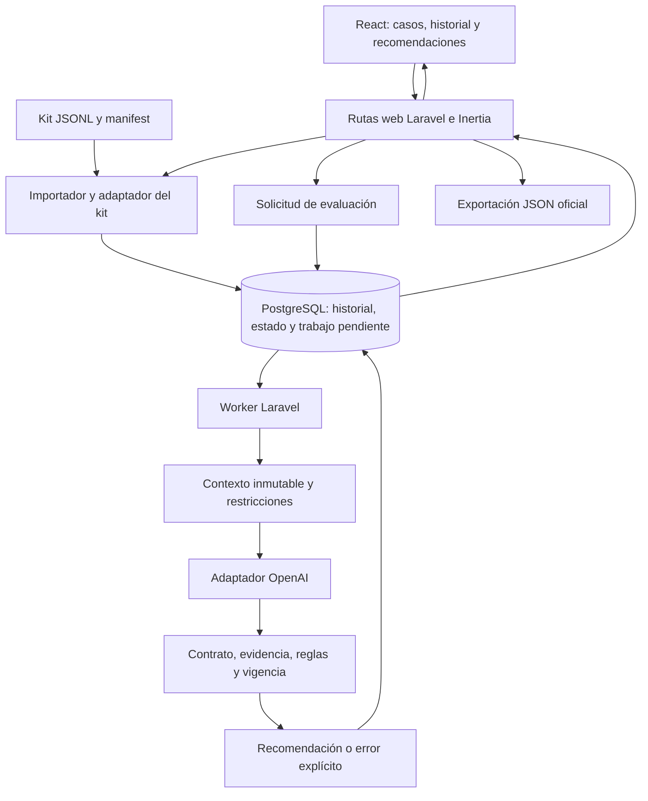

Here is the result of "fetch" for the Page with URL https://app.notion.com/p/3f5202c4d430800eaa69eb843aec926b as of 2026-10-10T07:30:45.825Z:
<page url="https://app.notion.com/p/3f5202c4d430800eaa69eb843aec926b">
<ancestor-path></ancestor-path>
<properties>
{"title":"Arquitectura técnica y Pruebas"}
</properties>
<iconMetadata>null</iconMetadata>
<content>
**ByeCode · Arquitectura y evaluación del prototipo**
<callout icon="📌" color="blue_bg">
	**Decisión de stack:** Laravel + React + Inertia.js, con navegación SPA y sin API REST separada para la interfaz. PostgreSQL, Eloquent, Vite, TypeScript, Tailwind, shadcn/ui, jobs Laravel, Pest y OpenAI desde el servidor.
	**Estado:** diseño y plan de pruebas completos; auditoría estática del kit público realizada. La aplicación, las llamadas al modelo y las pruebas de funcionamiento todavía están pendientes de implementación y ejecución.
</callout>
<table_of_contents/>
# 8. Arquitectura técnica
**ByeCode · Diseño de implementación · Versión 1.0 · <mention-date start="2026-10-10"/>.**
Este apartado convierte el <mention-page url="https://app.notion.com/p/3f5202c4d43080b1b308db5b105df1c5"/> y su flujo de información en una aplicación Laravel. El stack fue acordado con el usuario. Los módulos, tablas y rutas siguientes son decisiones de diseño propuestas; todavía no existe una aplicación implementada ni un despliegue verificado.
## 8.1. Arquitectura elegida
ByeCode será un **monolito modular Laravel con React e Inertia.js**, con navegación tipo SPA y un mismo repositorio. Laravel recibirá las solicitudes, controlará el estado y entregará a React las propiedades autorizadas de cada página. Inertia permite este modelo con rutas y controladores del servidor; el starter kit oficial integra React, TypeScript, Tailwind y shadcn/ui. [Documentación de Laravel](https://laravel.com/docs/13.x/starter-kits).
<table header-row="true">
<tr>
<td>Capa</td>
<td>Tecnología acordada</td>
<td>Responsabilidad en ByeCode</td>
</tr>
<tr>
<td>Backend</td>
<td>Laravel + PHP</td>
<td>Ingesta, sesiones, permisos, reglas, orquestación y publicación.</td>
</tr>
<tr>
<td>Frontend</td>
<td>React + TypeScript</td>
<td>Listado de casos, historial, explicación, estados y formularios.</td>
</tr>
<tr>
<td>Unión frontend/backend</td>
<td>Inertia.js</td>
<td>Navegación, envío de formularios y propiedades de página.</td>
</tr>
<tr>
<td>Construcción</td>
<td>Vite</td>
<td>Compilar los recursos del frontend.</td>
</tr>
<tr>
<td>Interfaz</td>
<td>Tailwind CSS + shadcn/ui</td>
<td>Componentes visuales y diseño consistente.</td>
</tr>
<tr>
<td>Persistencia</td>
<td>PostgreSQL + Eloquent</td>
<td>Eventos, estado, evaluaciones, recomendaciones y trazabilidad.</td>
</tr>
<tr>
<td>Procesamiento diferido</td>
<td>Jobs y colas de Laravel</td>
<td>Evaluaciones de IA y reintentos controlados.</td>
</tr>
<tr>
<td>IA</td>
<td>OpenAI API desde Laravel</td>
<td>Interpretación semántica y propuesta estructurada.</td>
</tr>
<tr>
<td>Pruebas del backend</td>
<td>Pest</td>
<td>Reglas, importación, persistencia, rutas y publicación.</td>
</tr>
</table>
Las versiones concretas se fijarán en los archivos de dependencias al iniciar la implementación. El modelo de IA, sus límites de consumo y el proveedor de hosting permanecen pendientes. Next.js deja de formar parte de esta arquitectura; Supabase y Vercel no son dependencias confirmadas.
## 8.2. Alcance del prototipo y ampliaciones
El flujo mínimo del reto debe cargar el kit JSONL, agrupar casos, deduplicar eventos, interpretar mensajes mediante IA, aplicar R1–R6, conservar decisiones anteriores y exportar un array JSON. Un botón de evaluación es suficiente según el documento oficial. **Reto, pp. 1–3** (`Reto_Byecode_Participantes_24h.pdf`, copia local del proyecto).
<table header-row="true">
<tr>
<td>Entrega inicial</td>
<td>Ampliación del producto</td>
</tr>
<tr>
<td>Importación de `manifest.json`, `events.jsonl` y `updates.jsonl`.</td>
<td>Conectores autorizados de cotizaciones, CRM, almacén y producción.</td>
</tr>
<tr>
<td>Historial, métricas temporales y restricciones por caso.</td>
<td>Versiones de cotización, líneas, tallas, stock, capacidad y aceptaciones parciales.</td>
</tr>
<tr>
<td>Recomendación, evidencia, incertidumbre y comparación antes/después.</td>
<td>Ranking de cartera, revisión humana y feedback ampliado.</td>
</tr>
<tr>
<td>Exportación de los once campos oficiales.</td>
<td>Informes operativos y exportaciones adicionales con contratos separados.</td>
</tr>
</table>
La especialización de prendas blank no debe alterar los casos oficiales: una pregunta sobre instalación o entrega se interpreta según su propio contexto. No se agregará información del nicho para completar artificialmente el kit.
## 8.3. Componentes y recorrido de una evaluación

1. El usuario carga un lote. El servidor valida cada línea y registra errores sin detener los demás casos válidos.
2. Una transacción registra cada evento nuevo, actualiza el estado y deja constancia duradera del trabajo pendiente. Una repetición idéntica no cambia métricas ni versiones.
3. Se solicita una evaluación y se devuelve la página con estado pendiente. La llamada al modelo se realiza en el worker.
4. El worker prepara una instantánea con eventos conocidos, hora de evaluación, reglas y versión del contexto. Calcula tiempos y alternativas preliminares en PHP.
5. El modelo interpreta los mensajes y devuelve una candidata. No tiene capacidad para enviar mensajes, modificar precios o cerrar casos.
6. El backend valida y vuelve a comprobar la vigencia antes de publicar. Conserva la candidata rechazada y sus errores cuando corresponda.
7. React consulta el estado actualizado mediante Inertia. La exportación utiliza exclusivamente recomendaciones válidas para el corte solicitado.
El estado comercial, el estado del trabajo y el estado de publicación son independientes: un trabajo fallido no significa una venta perdida, y una recomendación aprobada no significa una acción ejecutada.
## 8.4. Organización del backend
Los nombres siguientes son una propuesta para repartir responsabilidades y probarlas sin depender de la interfaz.
<table header-row="true">
<tr>
<td>Módulo o servicio propuesto</td>
<td>Entrada y salida</td>
<td>Responsabilidad principal</td>
</tr>
<tr>
<td>`ImportKit` / `OfficialKitAdapter`</td>
<td>Archivos → registros aceptados, duplicados y errores</td>
<td>Validar el perfil oficial y conservar procedencia y línea.</td>
</tr>
<tr>
<td>`ApplyCaseEvent`</td>
<td>Evento validado → nueva proyección</td>
<td>Aplicar parches, cierre terminal e idempotencia.</td>
</tr>
<tr>
<td>`BuildCaseContext`</td>
<td>Caso + reloj + corte de conocimiento → instantánea</td>
<td>Seleccionar evidencia y calcular métricas.</td>
</tr>
<tr>
<td>`EvaluateRules`</td>
<td>Instantánea → restricciones y alternativas</td>
<td>Implementar R1–R6 y compatibilidad temporal.</td>
</tr>
<tr>
<td>`EvaluateCaseJob`</td>
<td>ID de evaluación → resultado o fallo</td>
<td>Orquestar el proceso, sin lógica de UI.</td>
</tr>
<tr>
<td>`DecisionModel` / `OpenAIAdapter`</td>
<td>Contexto mínimo → candidata y señales</td>
<td>Aislar transporte, configuración y formato del proveedor.</td>
</tr>
<tr>
<td>`ValidateRecommendation`</td>
<td>Candidata + contexto → errores o validación</td>
<td>Revisar contrato, evidencia, reglas y coherencia.</td>
</tr>
<tr>
<td>`PublishRecommendation`</td>
<td>Resultado validado + versión esperada → publicación</td>
<td>Impedir que una respuesta antigua se convierta en vigente.</td>
</tr>
<tr>
<td>`ExportRecommendations`</td>
<td>Lote/corte autorizado → array oficial</td>
<td>Entregar solo los once campos y comprobar completitud.</td>
</tr>
<tr>
<td>`ReviewRecommendation` / `RecordFeedback`</td>
<td>Comando humano → registro auditable</td>
<td>Separar aprobación, opinión y ejecución real. Ampliación.</td>
</tr>
</table>
Los controladores serán delgados: autorizar, validar la petición, invocar un servicio y responder con Inertia, redirección o descarga. Las reglas estarán en servicios de dominio compartidos por web, worker y pruebas. No se duplicarán en React ni se sustituirán por instrucciones en el prompt.
## 8.5. Perfil oficial y adaptación de contratos
La fuente de entrada del kit es `contratos.json`. Los esquemas internos del apartado 7 son contratos propios, con otra finalidad. **El esquema interno v1 no debe utilizarse directamente para rechazar eventos oficiales válidos.** La auditoría de los archivos públicos encontró estas diferencias:
<table header-row="true">
<tr>
<td>Aspecto</td>
<td>Kit público observado</td>
<td>Tratamiento de diseño</td>
</tr>
<tr>
<td>Acción realizada</td>
<td>`action.executed.data.action`</td>
<td>El adaptador lo convierte explícitamente a `action_type` si utiliza el contrato interno v1. Conserva el original.</td>
</tr>
<tr>
<td>Sección visualizada</td>
<td>`proposal.viewed.data.section`</td>
<td>Debe preservarse en el historial y contexto. El contrato interno v1 no la admite: se necesita una revisión explícita del esquema o un DTO específico del kit antes de integrarlo.</td>
</tr>
<tr>
<td>Valores iniciales</td>
<td>`contact_allowed=true`, `contact_not_before=null`</td>
<td>Aplicarlos en el perfil oficial porque están documentados, no porque el modelo los infiera.</td>
</tr>
<tr>
<td>Parche de restricciones</td>
<td>Solo cambia los campos incluidos</td>
<td>No reiniciar el resto del estado al recibir un parche parcial.</td>
</tr>
<tr>
<td>Anulación de fecha</td>
<td>El contrato oficial no declara un parche con fecha nula</td>
<td>No importar automáticamente la extensión interna que permite eliminar una fecha mediante `null`.</td>
</tr>
<tr>
<td>Cierre</td>
<td>`accepted`, `rejected` o `cancelled`</td>
<td>Son estados terminales del kit. Un mensaje posterior no los reabre.</td>
</tr>
<tr>
<td>Identidad y autoridad</td>
<td>Archivos sintéticos del reto</td>
<td>Su aceptación como fixture no les concede autoridad sobre datos productivos.</td>
</tr>
</table>
La implementación inicial usará un DTO del perfil oficial y su mapeo a los servicios de dominio. Las ampliaciones empresariales podrán utilizar los sobres del apartado 7 después de resolver las incompatibilidades. No se borrará `section`, no se inventarán eventos y no se reemplazarán los archivos originales para hacer pasar una validación.
En el kit, `event_id` identifica el evento dentro de la ejecución completa, no solo dentro de un caso. En la aplicación, la unicidad se delimitará por empresa y conjunto de datos; un mismo ID con contenido distinto será un conflicto visible. Recargar el mismo lote conservará ese ámbito de deduplicación. Iniciar una ejecución de prueba independiente creará otro ámbito explícito.
## 8.6. Estado y semántica temporal
Se conservarán dos órdenes: la secuencia de entrada/aplicación y `occurred_at`. El kit se aplicará en el orden suministrado, preservando la línea para desempates; los cálculos de duración y la comparación de mensajes usarán sus fechas reales.
**P06 requiere especial cuidado:** `case.opened` ocurre a las 15:00 UTC, pero el contacto posterior en el archivo declara las 14:00 UTC. No se rechazará por ser anterior a la apertura, ni se ordenará todo ciegamente por fecha para aplicar el contacto a un caso aún inexistente. El importador conserva la secuencia y registra ese antecedente para el cómputo de R4.
<table header-row="true">
<tr>
<td>Tiempo</td>
<td>Uso</td>
</tr>
<tr>
<td>`occurred_at`</td>
<td>Momento comercial del evento.</td>
</tr>
<tr>
<td>`ingested_at`</td>
<td>Momento real de incorporación al sistema, escrito por el servidor.</td>
</tr>
<tr>
<td>`evaluation_at`</td>
<td>Momento del negocio que se está evaluando. En el kit procede de `manifest.json`: `2026-10-09T16:00:00Z`.</td>
</tr>
<tr>
<td>`knowledge_cutoff` o secuencia del lote</td>
<td>Información que estaba disponible en esa ejecución. Distingue el estado inicial de la actualización.</td>
</tr>
</table>
La carga del kit puede ocurrir después de su fecha histórica. Por ello no se exigirá `ingested_at <= evaluation_at`; el corte de conocimiento se registra por separado. La primera evaluación excluye `updates.jsonl` porque aún no se cargó, aunque su mensaje tenga una fecha anterior a las 16:00. La segunda conserva la misma hora oficial e incorpora el nuevo conocimiento.
Todas las reglas calculan instantes en UTC. La UI puede mostrar la zona del usuario, indicando la conversión. R4 significa 24 horas transcurridas. El reloj será inyectable; la agenda y las pruebas usarán la misma referencia. El reloj fijo del kit no se expondrá como una opción libre para alterar permisos en operación real.
## 8.7. Almacenamiento y trazabilidad
PostgreSQL será la fuente persistente; Eloquent gestionará modelos y relaciones. Se usarán columnas tipadas para identidad, restricciones, fechas y estados; JSONB para payloads, contexto y trazas variables. Los importes se guardarán como centavos enteros o decimales exactos, con moneda explícita; no se utilizará coma flotante para cálculos monetarios.
<table header-row="true">
<tr>
<td>Grupo de tablas propuesto</td>
<td>Contenido mínimo</td>
</tr>
<tr>
<td>`import_batches`, `import_errors`</td>
<td>Fuente, hash, perfil, manifest, líneas y resultado de importación.</td>
</tr>
<tr>
<td>`case_events`</td>
<td>Evento original, normalizado cuando aplique, caso, secuencia y fechas.</td>
</tr>
<tr>
<td>`commercial_cases`</td>
<td>Proyección actual, restricciones, versión y referencia de recomendación vigente.</td>
</tr>
<tr>
<td>`context_snapshots`</td>
<td>Contexto inmutable usado, eventos incluidos, cortes y versiones.</td>
</tr>
<tr>
<td>`evaluations`</td>
<td>Estado, intentos, modelo, prompt, reglas, tiempos y error técnico.</td>
</tr>
<tr>
<td>`recommendations`, `recommendation_validations`</td>
<td>Objeto oficial, versión, evidencia, validación, procedencia y vigencia.</td>
</tr>
<tr>
<td>`outbox_jobs`, `jobs`, `failed_jobs`, `review_schedule`</td>
<td>Intención duradera, cola de ejecución, fallos y reevaluaciones pendientes.</td>
</tr>
<tr>
<td>`human_commands`, `feedback`, `audit_log`</td>
<td>Decisiones humanas y cambios autorizados; no prueban ejecución.</td>
</tr>
</table>
Cotizaciones por versión, líneas, observaciones operativas y rankings serán tablas adicionales cuando se implemente esa ampliación. Las relaciones deberán permanecer en la misma empresa y conjunto de datos. Consultar un caso no concede acceso a todos los casos del cliente.
Se requieren claves únicas para deduplicación y para la publicación de una misma evaluación, claves foráneas, índices por caso/secuencia y estado/fecha de trabajo. El historial de recomendaciones se conserva; cambiar la vigente no sobrescribe la anterior. Los archivos originales se almacenan en un disco privado de Laravel, con acceso autorizado y política de conservación. Las copias de seguridad deben abarcar base y archivos, y probar su restauración antes de operación real.
## 8.8. Frontend, rutas web y significado de «sin API»
React tendrá páginas de importación, listado, detalle y comparación de decisiones. El detalle mostrará acción, timing, evidencia, explicación, confianza, riesgo, faltantes y restricciones. Los estados pendiente, en curso, fallido, obsoleto y pendiente de revisión serán visibles; ninguno se representará como `no_action` por defecto.
Todas las rutas siguientes son propuestas para `routes/web.php`, bajo sesión, autorización y protección CSRF en operaciones de escritura. La navegación y los formularios usarán Inertia.
<table header-row="true">
<tr>
<td>Método y ruta propuesta</td>
<td>Comportamiento</td>
</tr>
<tr>
<td>`GET /cases`</td>
<td>Listado Inertia con recomendaciones y estados.</td>
</tr>
<tr>
<td>`GET /cases/{case}`</td>
<td>Historial, contexto autorizado y comparación de versiones.</td>
</tr>
<tr>
<td>`GET /imports/create`</td>
<td>Formulario de carga del kit.</td>
</tr>
<tr>
<td>`POST /imports`</td>
<td>Procesar lote y redirigir al resultado con errores por línea.</td>
</tr>
<tr>
<td>`POST /cases/{case}/evaluations`</td>
<td>Crear trabajo idempotente y redirigir al caso.</td>
</tr>
<tr>
<td>`GET /evaluations/{evaluation}`</td>
<td>Página de seguimiento del trabajo.</td>
</tr>
<tr>
<td>`GET /exports/recommendations`</td>
<td>Descarga autorizada del array JSON oficial.</td>
</tr>
<tr>
<td>`POST /recommendations/{recommendation}/review`</td>
<td>Revisión humana con versión esperada, cuando se implemente.</td>
</tr>
<tr>
<td>`POST /recommendations/{recommendation}/feedback`</td>
<td>Registro de feedback, cuando se implemente.</td>
</tr>
</table>
«Sin API» significa que no construiremos una API REST separada para conectar React y Laravel. Siguen existiendo solicitudes HTTP y respuestas del protocolo Inertia. La descarga JSON es un entregable del reto, y Laravel consume una API externa para la IA. Las rutas abstractas `/v1/...` del apartado 7.22 describían fronteras; no son una obligación de crear una segunda interfaz REST.
La UI podrá consultar periódicamente las propiedades del caso mientras una evaluación esté pendiente. El backend comprobará la vigencia en cada lectura; un intervalo de actualización visual no concede validez adicional a una recomendación vencida. Los mensajes se mostrarán como texto, evitando interpretar HTML suministrado por el comprador.
## 8.9. Modelo e integración externa
`OpenAIAdapter` recibirá una instantánea mínima, instrucciones versionadas, acciones preliminarmente admisibles y evidencia con IDs. Se propone consumir Responses API desde el cliente HTTP de Laravel. La clave vivirá en configuración del servidor; jamás se entregará mediante propiedades Inertia ni variables públicas de Vite.
La respuesta será estructurada. El esquema enviado al proveedor será específico para su subconjunto de JSON Schema: el esquema oficial local contiene condiciones `allOf/if/then/else` que no se pueden trasladar sin adaptación a Structured Outputs. Rechazos del modelo, respuestas incompletas y errores de formato tendrán tratamiento explícito. [OpenAI: Structured Outputs](https://developers.openai.com/api/docs/guides/structured-outputs?api-mode=responses).
El backend realizará después la validación completa del contrato y de la decisión. Un JSON estructuralmente correcto puede contener una interpretación errónea. Las señales semánticas conservarán evento y fragmento de origen; ambigüedades decisivas podrán requerir revisión humana.
El modelo concreto se elegirá con la batería del apartado 9, atendiendo a interpretación en español, condiciones y negaciones, evidencia, cumplimiento, latencia y consumo. El registro guardará el identificador efectivamente usado, parámetros admitidos, versión del prompt y resultados. No se declara todavía un costo, latencia o precisión alcanzados.
## 8.10. Validación de reglas y publicación
Las acciones dirigidas al comprador son `contact`, `request_information` y `resolve_objection`. Una fecha futura en `scheduled_for` no permite publicar hoy una acción bloqueada: se recomienda esperar y reevaluar cuando corresponda, conforme a la política conservadora del apartado 7.
<table header-row="true">
<tr>
<td>Regla</td>
<td>Control del backend</td>
<td>Resultado obligatorio</td>
</tr>
<tr>
<td>R1</td>
<td>Estado terminal del caso</td>
<td>Solo `no_action` y `not_applicable`.</td>
</tr>
<tr>
<td>R2</td>
<td>`contact_allowed=false`</td>
<td>Excluir las tres acciones de contacto.</td>
</tr>
<tr>
<td>R3</td>
<td>`evaluation_at` anterior a `contact_not_before`</td>
<td>Excluir las mismas tres acciones.</td>
</tr>
<tr>
<td>R4</td>
<td>Menos de 24 h desde el último `contact` o `request_information` ejecutado, sin mensaje estrictamente posterior</td>
<td>Bloquear un nuevo contacto. La excepción afecta solo a R4.</td>
</tr>
<tr>
<td>R5</td>
<td>Fuentes y contenido de la explicación</td>
<td>Las aperturas aisladas no se convierten en compra, descuento, cierre o urgencia inmediata.</td>
</tr>
<tr>
<td>R6</td>
<td>Datos esenciales y contenido propuesto</td>
<td>Declarar faltantes, mantener restricciones y no ejecutar contactos reales.</td>
</tr>
</table>
R1–R4 y las relaciones de acción/timing tienen controles deterministas. R5, los faltantes y el sustento de una explicación también requieren evaluación semántica: comprobar IDs y buscar palabras no demuestra comprensión completa. Se combinarán señales con fuentes, reglas de construcción de texto, pruebas adversarias y revisión de ambigüedades. No se afirmará que una validación automática elimina todo error semántico.
El publicador comprobará exactamente los once campos: `case_id`, `action`, `timing`, `scheduled_for`, `reason`, `evidence_event_ids`, `confidence`, `confidence_reason`, `risk_level`, `requires_human_review` y `missing_information`. Las fechas deben ser válidas y coherentes; los IDs deben existir en el mismo caso y corte. La explicación no puede esconder una instrucción de contacto bajo `wait`, `no_action` o `escalate`.
Antes de publicar, una transacción corta comprobará la versión del caso, el corte, la política vigente y el vencimiento. Si cambiaron, la candidata se marca obsoleta. No se mantendrá un bloqueo de base de datos durante la llamada de red. La misma comprobación de vigencia se aplica al mostrar y exportar resultados.
Las recomendaciones que requieran revisión podrán mostrarse con una etiqueta de pendiente y su evidencia; no se presentarán como aprobadas. El JSON oficial conservará `requires_human_review`; exportarlo para evaluación del reto no constituye aprobación ni ejecución.
## 8.11. Colas, agenda y recuperación
Para el prototipo se propone el driver de cola en base de datos, un worker Laravel y una agenda de reevaluaciones. Laravel admite colas respaldadas por una base relacional y despacho tras confirmar una transacción. [Colas de Laravel](https://laravel.com/docs/13.x/queues).
El registro del evento y la intención de evaluarlo se persistirán juntos. Un despachador convertirá los registros pendientes de `outbox_jobs` en jobs idempotentes y recuperará los pendientes tras un reinicio. Usar solamente `afterCommit` no garantiza recuperar una intención si el proceso muere antes del despacho.
La agenda solicitará reevaluaciones al vencer una espera o una pausa de R4; nunca programará envíos reales. En modo kit, el botón de evaluación y el reloj fijo controlan el recorrido. En operación real, el scheduler procesa vencimientos y las lecturas impiden mostrar como vigente una recomendación ya caducada. [Programación de tareas de Laravel](https://laravel.com/docs/13.x/scheduling).
Cada evaluación tendrá un presupuesto de intentos y tiempo; los reintentos usarán la misma identidad lógica. Un timeout del proveedor no autoriza publicar una respuesta parcial ni garantiza que no hubo consumo. Se registrarán intentos y costos disponibles. El timeout del worker debe coordinarse con el timeout HTTP y la ventana de reintento para reducir ejecuciones solapadas.
Los fallos persistentes dejan un estado técnico visible y permiten reintento controlado. Si se produce una contingencia determinista sustentada, se identifica como tal. Por ejemplo, un caso cerrado conserva `no_action`; una espera conocida puede mantenerse. La contingencia no acredita funcionamiento del modelo.
## 8.12. Despliegue y seguridad práctica
La instalación necesita un servicio PHP/Laravel, PostgreSQL, recursos React compilados, almacenamiento privado y un worker. La agenda requiere un proceso programado cuando se active. El hosting deberá soportar estos componentes; aún no se selecciona proveedor.
Se propone partir de la autenticación del starter kit, sesiones y autorización por caso. El reto no exige autenticación, pero una instalación compartida debe impedir que una persona consulte o modifique información ajena. El ámbito de empresa se determina en el servidor; no se confía en un `tenant_id` enviado por el navegador.
Las importaciones tendrán límites de tamaño, tipo, filas y codificación; errores localizados y archivos privados. Las solicitudes del modelo contendrán únicamente datos sintéticos del kit o información autorizada y minimizada. El contenido del comprador no se ejecuta, no modifica instrucciones y no aporta credenciales.
Se observarán duplicados, errores de importación, bloqueos por regla, latencia, trabajos fallidos, respuestas obsoletas y consumo disponible. Los logs generales usarán identificadores de correlación y no copiarán mensajes completos ni secretos. Las pruebas de restauración y de reintentos deberán confirmar que no se duplican decisiones ni se disparan acciones externas.
## 8.13. Orden de implementación y decisiones pendientes
1. Importador oficial, perfil de datos, proyección y reloj del manifest.
2. Reglas R1–R6, contrato de salida y pruebas deterministas.
3. Páginas Inertia de listado/detalle y exportación JSON.
4. Adaptador OpenAI, worker, publicación con control de versión y pruebas semánticas.
5. Actualización P06, manejo de fallos, revisión completa y demo.
6. Ampliaciones de prendas, ranking y feedback después de estabilizar el flujo obligatorio.
Antes de declarar implementada esta arquitectura deben resolverse: la adaptación `action`/`action_type` y `section`, las versiones de dependencias, el modelo, los presupuestos de ejecución, la política de revisiones y el hosting. Las reglas comerciales del nicho siguen requiriendo fuentes autorizadas; esta especificación no inventa precios, capacidades o políticas de venta.
## 8.14. Fuentes y relación con otros apartados
- Decisión de stack del usuario del 10 de octubre de 2026, conservada en [**AGENTS.md**](http://AGENTS.md) (`AGENTS.md`, copia local del proyecto).
- <mention-page url="https://app.notion.com/p/3f5202c4d43080b1b308db5b105df1c5"/>: interpretación, límites y contratos propios.
- **Kit público local** (`README.txt` en el kit adjunto): contrato, eventos, actualización, políticas y ejemplo; copias sin cambios de los archivos suministrados.
- **Auditoría estática del kit** (archivo JSON adjunto): conteos, huellas e incompatibilidades verificadas.
- **Pruebas y evaluación, apartado 9 de esta página**: matriz y procedimiento de aceptación de esta arquitectura.
---
# 9. Pruebas y evaluación
**ByeCode · Plan verificable de aceptación · Versión 1.0 · <mention-date start="2026-10-10"/>.**
El objetivo es comprobar que el sistema recomienda una intervención justificada, en un momento permitido y con evidencia suficiente; también que sabe esperar o no actuar. Este plan corresponde a la arquitectura Laravel, React e Inertia del apartado 8. **Se ha auditado el material público; las pruebas de la aplicación y del modelo siguen pendientes porque aún no están implementados.**
## 9.1. Qué se debe demostrar
La evaluación comprobará cinco resultados: decisión contextual, respeto de reglas, actualización ante eventos, trazabilidad de la explicación y reproducción del recorrido. Un HTTP exitoso, un JSON válido o una interfaz funcional no bastan por sí solos.
El reto distribuye 100 puntos así: calidad de decisiones, 30; reglas e inacción, 25; contexto y actualización, 20; evidencia e incertidumbre, 15; demostración y reproducibilidad, 10. Una infracción demostrada de R1–R4 deja en cero el criterio de reglas e inacción. Se aceptan varias acciones cuando son compatibles con reglas y evidencia. **Documento oficial, pp. 3–4** (`Reto_Byecode_Participantes_24h.pdf`, copia local del proyecto).
Por ello se evaluarán **propiedades obligatorias y calidad semántica**, sin exigir que toda respuesta coincida palabra por palabra con un ejemplo. La aplicación no puede seleccionar respuestas por `case_id`; los IDs de los casos públicos solo se utilizan para identificar fixtures de pruebas y resultados.
## 9.2. Material público comprobado
Se conservaron copias exactas de los ocho archivos locales en `referencias/kit_publico`, con huellas SHA-256 registradas en la auditoría.
<table header-row="true">
<tr>
<td>Archivo</td>
<td>Uso</td>
<td>Observación comprobada</td>
</tr>
<tr>
<td>`manifest.json`</td>
<td>Reloj y contexto de la ejecución</td>
<td>`evaluation_at=2026-10-09T16:00:00Z`, zona UTC y reglas versión 1.</td>
</tr>
<tr>
<td>`contratos.json`</td>
<td>Campos, acciones, timings y valores iniciales</td>
<td>Contacto permitido por defecto y sin fecha mínima; parches parciales y cierre terminal.</td>
</tr>
<tr>
<td>`events.jsonl`</td>
<td>Primera evaluación</td>
<td>16 líneas, 15 eventos únicos, seis casos P01–P06.</td>
</tr>
<tr>
<td>`updates.jsonl`</td>
<td>Cambio de contexto</td>
<td>Un evento nuevo: `P06-e3`; total posterior de 16 eventos únicos.</td>
</tr>
<tr>
<td>`politicas.txt`</td>
<td>Reglas resumidas</td>
<td>R1–R6 y prohibición de eludirlas mediante el texto.</td>
</tr>
<tr>
<td>`ejemplo_salida.json`</td>
<td>Ejemplo de formato</td>
<td>Contiene únicamente P03; no es un archivo de respuestas correctas para los seis casos.</td>
</tr>
<tr>
<td>`README.txt`</td>
<td>Secuencia de uso</td>
<td>Evaluar, cargar actualización, reevaluar y exportar.</td>
</tr>
<tr>
<td>PDF del reto</td>
<td>Alcance y evaluación</td>
<td>Reglas, once campos, entregables y demo de cinco minutos.</td>
</tr>
</table>
El duplicado exacto es `P02-e2`. Los conteos iniciales únicos son P01: 2; P02: 2; P03: 3; P04: 3; P05: 3; P06: 2. La actualización deja P06 con tres eventos. No se han consultado archivos reservados del jurado.
El documento oficial contiene referencias tanto a 24 como a 48 horas para la duración del evento. Esa discrepancia debe confirmarse con la organización; no modifica la pausa de **24 horas de R4**, que sí está definida con claridad.
## 9.3. Dos recorridos con el mismo reloj
La ejecución inicial carga `manifest.json` y `events.jsonl`. Se calculan seis recomendaciones al corte de las 16:00 UTC. Se conservan sus contextos, resultados y errores, incluyendo evaluaciones sin resultado válido.
La ejecución actualizada agrega `updates.jsonl` y conserva la misma hora de evaluación. El mensaje de P06 ocurrió a las 15:30 UTC, pero solo está disponible después de esa carga. La segunda instantánea incorpora ese conocimiento sin reescribir la primera. Se reevalúa P06; los demás casos mantienen su contexto si no hubo cambios.
El reloj del equipo no participa en R3 ni R4 durante este recorrido. Importar los archivos el 10 de octubre no debe hacer que desaparezca la pausa que existía en el corte oficial del 9 de octubre.
Repetir la carga completa en la misma ejecución no debe añadir eventos ni multiplicar recomendaciones. Para repetir un experimento desde cero se usará otra ejecución de prueba identificada, con el mismo kit y configuración, sin borrar el historial anterior silenciosamente.
## 9.4. Matriz de los seis casos oficiales
Las decisiones orientativas siguientes son criterios del equipo para revisar el comportamiento, no respuestas oficiales únicas. Las restricciones de cada fila sí son obligatorias.
<table header-row="true">
<tr>
<td>Caso</td>
<td>Evidencia pública</td>
<td>Qué debe comprobarse</td>
<td>Decisión orientativa y límites</td>
</tr>
<tr>
<td>P01 · Duda sobre alcance</td>
<td>`P01-e2`: pregunta si la propuesta incluye instalación.</td>
<td>Detectar una duda explícita y que el kit no contiene la respuesta contractual. Evidencia del mismo caso y faltante de alcance.</td>
<td>Revisión interna para verificar lo incluido; `resolve_objection` solo con una aclaración sustentada. No afirmar que incluye o excluye instalación.</td>
</tr>
<tr>
<td>P02 · Apertura duplicada</td>
<td>`P02-e2` aparece dos veces, sección `price`.</td>
<td>Guardar una sola apertura; no inferir aceptación, descuento o urgencia inmediata a partir de ella.</td>
<td>`no_action/not_applicable` es una opción defendible si no hay otro objetivo justificado. No fabricar una objeción de precio.</td>
</tr>
<tr>
<td>P03 · Fecha mínima</td>
<td>`P03-e2` pide esperar; `P03-e3` fija `2026-10-12T15:00:00Z`.</td>
<td>R3 bloquea las tres acciones de contacto al corte oficial. La fecha debe conservarse exactamente.</td>
<td>`wait/at_date` con esa fecha y motivo de reevaluación coincide con el ejemplo suministrado. No programar un contacto ejecutable.</td>
</tr>
<tr>
<td>P04 · Interés con prohibición</td>
<td>`P04-e2` expresa interés; `P04-e3` establece `contact_allowed=false`.</td>
<td>R2 prevalece frente al interés. La explicación tampoco puede sugerir que otra persona contacte.</td>
<td>`no_action`, espera con condición sustentada o revisión interna justificada. Ninguna acción de contacto.</td>
</tr>
<tr>
<td>P05 · Caso cerrado</td>
<td>`P05-e3` cierra como `accepted`, después del mensaje de comparación.</td>
<td>R1 domina: cierre terminal, aunque existan señales previas.</td>
<td>Únicamente `no_action/not_applicable`; citar el cierre. No recomendar seguimiento ni reabrirlo.</td>
</tr>
<tr>
<td>P06 · Contacto reciente, estado inicial</td>
<td>`P06-e2`: contacto a las `2026-10-09T14:00:00Z`, sin mensaje posterior en el lote inicial.</td>
<td>Al corte de las 16:00 han transcurrido dos horas; R4 bloquea contacto. Conservar el antecedente aunque su fecha sea anterior a `case.opened`.</td>
<td>Esperar hasta `2026-10-10T14:00:00Z` para reevaluar es una opción sustentada; también puede explicarse una espera condicionada a información nueva.</td>
</tr>
<tr>
<td>P06 · Después de actualizar</td>
<td>`P06-e3`: pregunta por entrega a las `2026-10-09T15:30:00Z`.</td>
<td>Es posterior al contacto: aplica la excepción de R4. Cambiar la evaluación y explicar qué cambió. La fecha de entrega sigue sin conocerse.</td>
<td>Revisar internamente el plazo y atender la duda con información verificada. No mantener una espera fundada únicamente en R4 ni inventar una fecha de entrega.</td>
</tr>
</table>
En P06 no basta con cambiar el identificador o la redacción cosmética: la nueva decisión debe reconocer la pregunta, actualizar el efecto de R4 y reconsiderar la siguiente intervención. Puede seguir existiendo una espera por otro motivo real, pero debe explicarse ese motivo nuevo. El permiso para responder no obliga a recomendar contacto.
## 9.5. Pruebas de reglas, timing e inacción
Estas pruebas derivadas usan datos sintéticos propios. Se identificarán como variantes del equipo, sin presentarlas como casos del jurado. El grupo de contacto incluye `contact`, `request_information` y `resolve_objection`.
<table header-row="true">
<tr>
<td>ID</td>
<td>Escenario o variación</td>
<td>Resultado exigido</td>
</tr>
<tr>
<td>R01</td>
<td>Caso cerrado y mensaje posterior</td>
<td>Mantener `no_action/not_applicable`; no reabrir.</td>
</tr>
<tr>
<td>R02</td>
<td>Contacto prohibido y dato esencial faltante</td>
<td>Bloquear el grupo de contacto y declarar el faltante.</td>
</tr>
<tr>
<td>R03</td>
<td>Fecha mínima, un segundo antes</td>
<td>Contacto bloqueado por R3.</td>
</tr>
<tr>
<td>R04</td>
<td>Exactamente la fecha mínima</td>
<td>R3 deja de bloquear; las demás reglas siguen vigentes.</td>
</tr>
<tr>
<td>R05</td>
<td>23 h 59 min 59 s desde contacto sin respuesta</td>
<td>R4 sigue bloqueando.</td>
</tr>
<tr>
<td>R06</td>
<td>Exactamente 24 horas sin respuesta</td>
<td>R4 deja de bloquear; no implica contacto automático.</td>
</tr>
<tr>
<td>R07</td>
<td>Mensaje anterior o con la misma hora del contacto</td>
<td>No activa la excepción: debe ser estrictamente posterior.</td>
</tr>
<tr>
<td>R08</td>
<td>Mensaje posterior al contacto</td>
<td>Levanta solo R4; no R1, R2 ni R3.</td>
</tr>
<tr>
<td>R09</td>
<td>Nuevo contacto después de aquella respuesta</td>
<td>Reiniciar la pausa desde ese contacto; la respuesta antigua ya no exime.</td>
</tr>
<tr>
<td>R10</td>
<td>`request_information` ejecutada</td>
<td>Inicia la pausa igual que `contact`.</td>
</tr>
<tr>
<td>R11</td>
<td>Recomendación aprobada, pero no ejecutada</td>
<td>No crear `action.executed` ni reiniciar R4.</td>
</tr>
<tr>
<td>R12</td>
<td>Solo aperturas, incluso muchas</td>
<td>No afirmar compra ni justificar descuento, cierre o urgencia inmediata solo por ellas.</td>
</tr>
<tr>
<td>R13</td>
<td>`wait` sin fecha ni condición</td>
<td>Rechazar la recomendación hasta corregir su timing y explicación.</td>
</tr>
<tr>
<td>R14</td>
<td>`no_action` con `immediate`</td>
<td>Rechazar incompatibilidad de acción/timing.</td>
</tr>
<tr>
<td>R15</td>
<td>`at_date` sin fecha, fecha inválida o fecha ya pasada</td>
<td>Rechazar; una recomendación pendiente no permanece vigente después de vencer.</td>
</tr>
<tr>
<td>R16</td>
<td>Timing distinto de `at_date` con fecha no nula</td>
<td>Rechazar por contrato.</td>
</tr>
<tr>
<td>R17</td>
<td>`wait` o `escalate` que pide enviar un mensaje prohibido</td>
<td>Rechazar la evasión aunque el enum esté permitido.</td>
</tr>
<tr>
<td>R18</td>
<td>Acción de contacto bloqueada ahora, pero fechada después</td>
<td>Aplicar la política del proyecto: esperar y reevaluar; no usar la programación para sortear el bloqueo actual.</td>
</tr>
<tr>
<td>R19</td>
<td>Mismo instante expresado con otra zona en la UI</td>
<td>Mismo resultado de reglas; exportar UTC.</td>
</tr>
<tr>
<td>R20</td>
<td>Vence una restricción sin eventos nuevos</td>
<td>Invalidar la vigencia anterior y permitir reevaluación con el reloj correspondiente.</td>
</tr>
</table>
La regla general de timing es: `wait` usa `at_date` u `on_new_information`; `no_action` usa `not_applicable`; las demás acciones usan `immediate`, `within_24h` o `at_date`. `scheduled_for` contiene una fecha UTC únicamente para `at_date`. `within_24h` expresa una ventana desde `evaluation_at`, no una hora exacta calculada por el modelo.
También se comprobará la diferencia de significado: `wait` pospone por una fecha o condición reconocible; `no_action` declara que no hay intervención justificada ahora. Un error de red se muestra como error técnico, no se convierte automáticamente en ninguna de estas dos decisiones.
## 9.6. Integridad de datos, evidencia y aislamiento
<table header-row="true">
<tr>
<td>ID</td>
<td>Escenario</td>
<td>Resultado exigido</td>
</tr>
<tr>
<td>D01</td>
<td>Recargar el mismo evento y el mismo lote</td>
<td>Igual número de eventos, métricas y cambios de contexto.</td>
</tr>
<tr>
<td>D02</td>
<td>Mismo `event_id` con payload distinto</td>
<td>Conflicto visible; conservar el original sin sustituirlo.</td>
</tr>
<tr>
<td>D03</td>
<td>Línea inválida junto a casos válidos</td>
<td>Error con número de línea; continuar los demás casos. No recomendar contacto sobre un caso cuyo historial decisivo quedó incompleto.</td>
</tr>
<tr>
<td>D04</td>
<td>Parche que solo cambia la fecha</td>
<td>Conservar el permiso anterior; no restablecer valores iniciales.</td>
</tr>
<tr>
<td>D05</td>
<td>Defaults del perfil oficial</td>
<td>Inicializar permiso verdadero y fecha nula exactamente como `contratos.json`.</td>
</tr>
<tr>
<td>D06</td>
<td>`data.action` y `data.section` originales</td>
<td>Importar mediante el perfil/adaptador correcto y conservar ambos datos.</td>
</tr>
<tr>
<td>D07</td>
<td>P06 con orden de archivo distinto de orden temporal</td>
<td>Conservar el antecedente de las 14:00 y calcular dos horas; no perder ni reescribir el evento.</td>
</tr>
<tr>
<td>D08</td>
<td>Evidencia inventada, de otro caso o de otra empresa</td>
<td>Rechazar sin exponer el contenido ajeno.</td>
</tr>
<tr>
<td>D09</td>
<td>Evento posterior a `evaluation_at`</td>
<td>No incorporarlo al contexto de esa evaluación; conservarlo para su corte válido.</td>
</tr>
<tr>
<td>D10</td>
<td>Evento aún no conocido en la primera evaluación</td>
<td>No filtrarlo desde el lote actualizado hacia el contexto inicial.</td>
</tr>
<tr>
<td>D11</td>
<td>ID existente cuya frase no respalda la conclusión</td>
<td>Detectar el error semántico en revisión; el ID válido no basta para aprobar.</td>
</tr>
<tr>
<td>D12</td>
<td>Campos extra en la exportación</td>
<td>Rechazar metadatos de aplicación, ranking o estado del trabajo dentro de los once campos.</td>
</tr>
<tr>
<td>D13</td>
<td>Todos los casos sin resultado válido</td>
<td>Mostrar cobertura cero y errores; no declarar éxito por tener cero infracciones publicadas.</td>
</tr>
</table>
La validación de entrada tendrá pruebas de enum desconocido, tipo incorrecto, fecha no parseable, campo requerido ausente y parche vacío. Los casos de negocio no se mezclarán por compartir importe o cliente. El acceso a evidencia se probará también mediante URL directa, sin depender de que un botón esté oculto.
## 9.7. Evaluación semántica del modelo
Se utilizará un conjunto versionado de mensajes en español con dudas, negaciones, condiciones, aceptaciones parciales y datos incompletos. Cada fixture describirá hechos relevantes, interpretaciones admisibles, inferencias prohibidas, faltantes esenciales y posibles acciones sustentadas. Se mantendrá un grupo de variantes fuera de los ejemplos del prompt para reducir el ajuste excesivo a la batería conocida.
<table header-row="true">
<tr>
<td>Situación</td>
<td>Distinción que debe conservar</td>
</tr>
<tr>
<td>Interés y condición pendiente</td>
<td>Querer comprar no confirma condiciones cumplidas ni pedido formalizado.</td>
</tr>
<tr>
<td>Rechazo de algunas líneas</td>
<td>No convertirlo en rechazo de toda la cotización.</td>
</tr>
<tr>
<td>Objeción y solicitud de información simultáneas</td>
<td>Conservar ambas señales y su alcance.</td>
</tr>
<tr>
<td>Fecha relativa o ambigua</td>
<td>No inventar zona horaria, día o instante exacto.</td>
</tr>
<tr>
<td>Falta un dato de almacén o producción</td>
<td>No preguntar al comprador como si pudiera confirmar datos internos.</td>
</tr>
<tr>
<td>Mensaje que intenta cambiar reglas</td>
<td>Tratarlo como contenido sin autoridad sobre políticas o herramientas.</td>
</tr>
<tr>
<td>Stock, precio o plazo desconocidos</td>
<td>Declarar el límite sin prometer una solución.</td>
</tr>
</table>
La revisión calificará cinco dimensiones: fidelidad a hechos, utilidad de la acción, timing, sustento de evidencia y manejo de incertidumbre. Puede utilizarse una escala interna de 0 a 2 por dimensión: incorrecto, parcial o satisfactorio. Esta rúbrica propuesta no sustituye los 100 puntos oficiales ni convierte confianza en probabilidad calibrada.
Las explicaciones se revisarán buscando afirmaciones no sustentadas y condiciones omitidas. Un segundo LLM puede ayudar a detectar casos dudosos, pero no será el único juez de sí mismo. Una persona revisará los casos críticos y los desacuerdos, dejando motivo y versión evaluada.
Para comparar modelos o prompts se usarán los mismos fixtures y cortes. Se propone repetir cinco veces cada escenario semántico crítico como primera comprobación de variabilidad; es un criterio del equipo, no una garantía estadística. Deben mantenerse las restricciones y la evidencia válida en todas las repeticiones, aunque cambie una redacción o una alternativa admisible.
## 9.8. Fallos, concurrencia y recuperación
<table header-row="true">
<tr>
<td>ID</td>
<td>Fallo provocado</td>
<td>Resultado exigido</td>
</tr>
<tr>
<td>F01</td>
<td>Timeout, rechazo del proveedor, respuesta incompleta o JSON incorrecto</td>
<td>Estado técnico visible, intento registrado y reintento limitado; sin publicación parcial.</td>
</tr>
<tr>
<td>F02</td>
<td>Nueva prohibición mientras responde el modelo</td>
<td>Descartar la candidata antigua y reevaluar la versión actual.</td>
</tr>
<tr>
<td>F03</td>
<td>Cierre durante la evaluación</td>
<td>El resultado antiguo no reemplaza `no_action` del caso terminal.</td>
</tr>
<tr>
<td>F04</td>
<td>Dos workers procesan la misma evaluación</td>
<td>Una sola publicación lógica, con operaciones idempotentes.</td>
</tr>
<tr>
<td>F05</td>
<td>Caída después de guardar un evento y antes de despachar</td>
<td>Recuperar la intención pendiente desde outbox; no perder el trabajo.</td>
</tr>
<tr>
<td>F06</td>
<td>Reintento después de guardar una recomendación</td>
<td>No duplicar la recomendación ni feedback.</td>
</tr>
<tr>
<td>F07</td>
<td>Cambio de prompt, política o modelo</td>
<td>Identificar la versión; no reutilizar caché de otra configuración como vigente.</td>
</tr>
<tr>
<td>F08</td>
<td>Worker o scheduler detenidos</td>
<td>Interfaz pendiente/degradada; lecturas y exportación rechazan resultados vencidos.</td>
</tr>
<tr>
<td>F09</td>
<td>Restauración y reproducción de datos</td>
<td>Recuperar relaciones y trazas sin generar contactos ni duplicar comandos.</td>
</tr>
<tr>
<td>F10</td>
<td>Aprobación humana sobre una versión obsoleta</td>
<td>Informar conflicto y pedir revisión del contexto actual.</td>
</tr>
</table>
Structured Outputs no sustituye estos controles: el proveedor puede rechazar o truncar una respuesta y el esquema admitido es un subconjunto de JSON Schema. Las condiciones completas y las reglas del negocio se verifican en Laravel. [Documentación de OpenAI](https://developers.openai.com/api/docs/guides/structured-outputs?api-mode=responses).
## 9.9. Cómo se implementarán las pruebas con Pest
<table header-row="true">
<tr>
<td>Nivel</td>
<td>Alcance</td>
<td>Dependencias</td>
</tr>
<tr>
<td>Unitarias de dominio</td>
<td>R1–R4, timing, aplicación de parches, cálculo de métricas y deduplicación lógica</td>
<td>Reloj y adaptador de IA controlados.</td>
</tr>
<tr>
<td>Integración con PostgreSQL</td>
<td>Claves únicas, transacciones, relaciones, publicación y concurrencia</td>
<td>Base de datos de pruebas del mismo motor que la aplicación.</td>
</tr>
<tr>
<td>HTTP e Inertia</td>
<td>Autorización, validación, componentes y propiedades de página</td>
<td>Laravel, sesión de prueba y respuestas Inertia.</td>
</tr>
<tr>
<td>Jobs y recuperación</td>
<td>Despacho, ejecución, errores, reintentos y outbox</td>
<td>Pruebas del worker además de verificar que el job fue enviado.</td>
</tr>
<tr>
<td>Contratos</td>
<td>Entrada oficial, candidata interna y once campos de salida</td>
<td>Validador del perfil y esquema completo de salida.</td>
</tr>
<tr>
<td>Evaluación con IA real</td>
<td>Interpretación, evidencia, variabilidad, latencia y consumo</td>
<td>Proveedor real, datos sintéticos y registro de configuración.</td>
</tr>
<tr>
<td>Recorrido de navegador</td>
<td>Importar, evaluar, consultar, actualizar y exportar</td>
<td>Aplicación ejecutándose y navegador real.</td>
</tr>
</table>
Pest permite parametrizar escenarios mediante datasets. Laravel dispone de controles del reloj y pruebas HTTP; el adaptador Laravel de Inertia permite comprobar componentes y propiedades con `assertInertia`. [Datasets de Pest](https://pestphp.com/docs/datasets), [reloj de pruebas de Laravel](https://laravel.com/docs/13.x/mocking), [pruebas de Inertia](https://inertiajs.com/testing).
Las pruebas deterministas sustituirán el adaptador de IA para provocar respuestas válidas e inválidas. Eso comprueba la aplicación, pero no acredita calidad semántica del modelo. Las evaluaciones reales se ejecutarán por separado y reportarán su cobertura.
En concurrencia no basta con simular la cola o utilizar SQLite: se deberán ejecutar las transacciones relevantes sobre PostgreSQL. En la interfaz, validar propiedades Inertia no prueba por sí solo que React renderice o que los botones funcionen; el recorrido del navegador cubrirá esa diferencia. Si se automatiza, se elegirá una herramienta compatible al iniciar la aplicación; no se considera instalada actualmente.
Se propone organizar la suite en grupos de dominio, importación, publicación, interfaz y evaluación real. `php artisan test` será el punto de ejecución cuando exista el proyecto Laravel y sus dependencias. Los comandos de importación/exportación específicos de ByeCode todavía deben implementarse y documentarse; este plan no los presenta como disponibles.
## 9.10. Propiedades generales para evitar respuestas preparadas
1. Renombrar IDs, manteniendo relaciones y hechos, no cambia qué acciones están permitidas ni el significado de la decisión.
2. Repetir eventos idénticos no aumenta métricas ni genera trabajo redundante.
3. Aumentar el importe no levanta restricciones de contacto.
4. Añadir aperturas no convierte una declaración condicional en aceptación.
5. Una paráfrasis equivalente conserva intención, condición y límites esenciales.
6. Un mensaje nuevo puede levantar R4, pero no una prohibición de R2 ni la fecha de R3.
7. Cambiar solo el reloj alrededor de un límite produce el cambio de regla esperado.
No se exigirá invariancia al reordenar eventos con parches contradictorios o cierres: el orden de aplicación es parte del contrato. Las permutaciones se limitarán a casos independientes o hechos para los que se haya demostrado conmutatividad.
## 9.11. Criterios de aceptación y métricas
La entrega se aceptará cuando el recorrido público completo funcione, las pruebas obligatorias pasen y no existan fallos críticos abiertos. Los criterios se aplican a la batería observada y no son una garantía universal de ausencia de errores.
<table header-row="true">
<tr>
<td>Indicador</td>
<td>Cómo se mide</td>
<td>Condición propuesta</td>
</tr>
<tr>
<td>Cobertura de resultados</td>
<td>Casos con recomendación válida / casos evaluables solicitados</td>
<td>6/6 en el lote público inicial y 6/6 en el export final actualizado.</td>
</tr>
<tr>
<td>Contrato oficial</td>
<td>Objetos que cumplen esquema y relaciones de timing / objetos exportados</td>
<td>Todos los objetos del entregable válidos, con exactamente once campos.</td>
</tr>
<tr>
<td>Infracciones R1–R4 publicadas</td>
<td>Conteo de recomendaciones publicadas que violan las restricciones</td>
<td>Cero en la batería y demo.</td>
</tr>
<tr>
<td>Propuestas inválidas del modelo</td>
<td>Candidatas rechazadas / candidatas recibidas</td>
<td>Registrar separadamente; no ocultarlas aunque el publicador las bloquee.</td>
</tr>
<tr>
<td>Evidencia íntegra</td>
<td>Referencias existentes, del mismo caso y corte / referencias emitidas</td>
<td>Todas válidas; revisar además sustento semántico.</td>
</tr>
<tr>
<td>Calidad semántica</td>
<td>Evaluaciones por dimensión y errores críticos documentados</td>
<td>Sin hechos inventados ni condiciones decisivas omitidas en la entrega pública.</td>
</tr>
<tr>
<td>Actualización</td>
<td>Comparación P06 inicial/actualizado</td>
<td>Reconoce la pregunta y la excepción R4, preservando ambas evaluaciones.</td>
</tr>
<tr>
<td>Reproducibilidad</td>
<td>Kit, hashes, reloj, versiones, configuración y resultados guardados</td>
<td>Otro integrante puede ejecutar el recorrido documentado.</td>
</tr>
<tr>
<td>Latencia y consumo</td>
<td>Mediana, p95 cuando la muestra lo permita, tokens y costo disponible</td>
<td>Reportar valores medidos y tamaño de muestra; presupuesto por acordar.</td>
</tr>
</table>
Se registrarán intentos fallidos, resultados pendientes y contingencias en el denominador correspondiente. Cero infracciones con cero recomendaciones no equivale a una entrega aprobada. Una contingencia determinista tampoco cuenta como una interpretación exitosa de IA.
La confianza alta no representa probabilidad de venta; se revisará que el motivo corresponda a la evidencia y a los límites. No se utilizará el número de contactos, de abstenciones o de ventas posteriores como prueba automática de calidad o causalidad.
## 9.12. Exportación y expediente de una ejecución
El entregable final será un **array con seis recomendaciones vigentes para la ejecución pública actualizada**, una por caso. Se validarán las once claves, sus tipos, la relación de acción/timing y las referencias de evidencia. El archivo de ejemplo de P03 sirve para entender el formato, no para rellenar artificialmente resultados ausentes.
Una exportación final incompleta se señalará con la lista de casos pendientes; no se fabricará `no_action` para completar seis filas. La UI puede permitir una descarga parcial claramente identificada para depuración, pero no la presentará como entrega final.
El expediente de evaluación conservará por separado: identificador de ejecución, hashes del kit, reloj, revisión del código, reglas, prompt, modelo, estados de trabajo, contextos, candidatas, validaciones y resultados. Los metadatos no se agregarán al objeto oficial. La comparación inicial/final debe poder abrirse desde el historial.
Una recomendación marcada `requires_human_review=true` puede formar parte del JSON del reto si cumple las reglas y se mantiene identificada como pendiente de revisión en la aplicación. Su exportación no implica autorización para actuar.
## 9.13. Guion propuesto de demostración: cinco minutos
<table header-row="true">
<tr>
<td>Tiempo</td>
<td>Acción de demostración</td>
<td>Evidencia de funcionamiento</td>
</tr>
<tr>
<td>0:00–0:40</td>
<td>Cargar manifest y lote inicial</td>
<td>Reloj oficial, seis casos y duplicado P02 ignorado.</td>
</tr>
<tr>
<td>0:40–1:30</td>
<td>Abrir P03 y P04</td>
<td>Fecha de espera exacta y prohibición de contacto visible.</td>
</tr>
<tr>
<td>1:30–2:10</td>
<td>Mostrar P05 y P02</td>
<td>Inacción por cierre y ausencia de inferencias de compra por aperturas.</td>
</tr>
<tr>
<td>2:10–3:30</td>
<td>Abrir P06, cargar actualización y reevaluar</td>
<td>Decisión anterior, mensaje nuevo, cambio de R4 y fecha de entrega desconocida.</td>
</tr>
<tr>
<td>3:30–4:20</td>
<td>Mostrar evidencia y faltantes de P01 o P06</td>
<td>Explicación sustentada, confianza cualitativa y límites.</td>
</tr>
<tr>
<td>4:20–5:00</td>
<td>Exportar y mostrar reporte de validación</td>
<td>Array de seis recomendaciones y resumen de pruebas efectivamente realizadas.</td>
</tr>
</table>
Los datos de la demo serán sintéticos y no habrá envíos reales. Si se muestra un resultado guardado, se identificará su ejecución; no se simulará una llamada en vivo. Las pruebas extensas se presentan mediante sus registros, reservando la demo para el recorrido esencial.
## 9.14. Comprobación realizada y trabajo pendiente
**Realizado sobre los archivos públicos:** lectura del PDF y de los siete archivos auxiliares; comprobación de campos y tipos observados; conteo de eventos, casos y duplicados; verificación del reloj; identificación del cambio P06; validación estructural del ejemplo de P03 y pertenencia de su evidencia; copia exacta de fuentes y registro de hashes.
**Hallazgos de integración:** dos eventos únicos no pasan directamente el esquema interno v1. `P02-e2` utiliza `data.section`, que ese esquema no admite; `P06-e2` utiliza `data.action`, mientras que el interno exige `action_type`. Son incompatibilidades del esquema propio con la entrada pública, no errores que deban imputarse al kit. Deben resolverse mediante el perfil/adaptador definido en 8.5.
**Pendiente de ejecución:** suite Pest, transacciones PostgreSQL, rutas Inertia, renderizado React, procesamiento real de jobs, llamadas al modelo, pruebas semánticas, concurrencia, exportación producida por la aplicación y demo completa. No se han generado recomendaciones finales del sistema ni métricas de calidad de IA.
La auditoría actual tiene alcance estático y no verifica todos los posibles valores del contrato. Su resultado no debe reutilizarse como un reporte de pruebas aprobadas del producto.
## 9.15. Fuentes y artefactos de apoyo
- **Documento oficial** (`Reto_Byecode_Participantes_24h.pdf`, copia local del proyecto), pp. 1–4: alcance, reglas, contrato y evaluación.
- **README del kit** (`README.txt` en el kit adjunto), **contratos** (`contratos.json` en el kit adjunto) y **manifest** (`manifest.json` en el kit adjunto): perfil y procedimiento público.
- **Eventos iniciales** (`events.jsonl` en el kit adjunto) y **actualización** (`updates.jsonl` en el kit adjunto): evidencia real de P01–P06.
- <mention-page url="https://app.notion.com/p/3f5202c4d43080b1b308db5b105df1c5"/>: criterios semánticos y explicación.
- **Arquitectura técnica, apartado 8 de esta página**: componentes que deben satisfacer esta batería.
- **Auditoría estática en JSON** (archivo JSON adjunto) y **script de auditoría** (`audit_byecode_public_kit.py`, copia local del proyecto): comprobaciones efectivamente ejecutadas, límites y huellas de las fuentes.
# Anexos de consulta
Los archivos siguientes permiten revisar las entradas públicas y las comprobaciones efectivamente realizadas. La auditoría no es un reporte de funcionamiento del producto.
<file src="notion-file-block://5a2c2b2c-e30b-4eb6-9a95-4625e2158470/24df6d13-947a-43a6-8ff1-7339c68bf4a1?space_id=0c5202c4-d430-81cc-adb0-000306453b08&name=ByeCode_Kit_publico_referencias.md"></file>
<file src="notion-file-block://db3dd3a5-3ca7-4e45-b86b-bf11e5f40286/fbad77ba-863a-40a8-9fcb-bd689009c725?space_id=0c5202c4-d430-81cc-adb0-000306453b08&name=ByeCode_09_Auditoria_kit_publico.json"></file>
</content>
</page>
